# C2L_Presentation_Hackathon_RevB.pdf

- Slides: 26
- Source: local, SHA-256 `0811454811e263e361418e76370906c1127c8e167e8ed228df468f22d252c94c`

## Slide 1 - `0811454811e2:1:62bf8717`

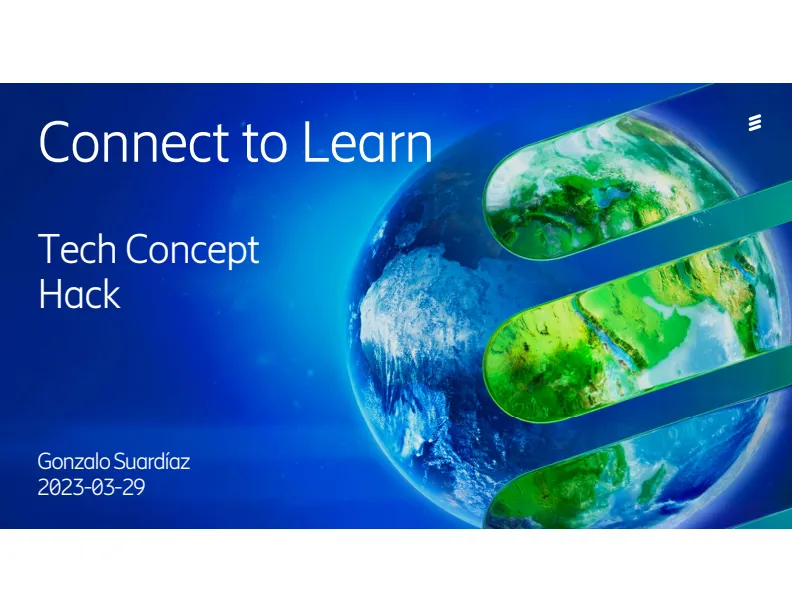

Connect to Learn
Tech Concept
Hack
Gonzalo Suardíaz
2023-03-29

## Slide 2 - `0811454811e2:2:5022169a`

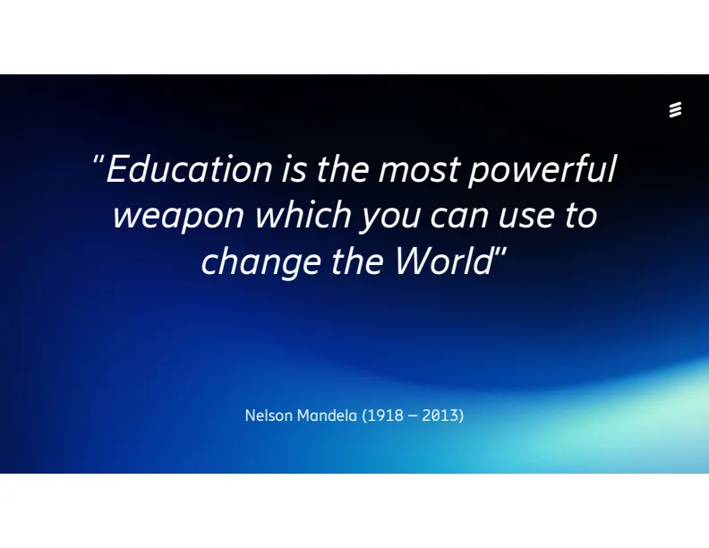

Nelson Mandela (1918 – 2013)
“Education is the most powerful 
weapon which you can use to 
change the World”

## Slide 3 - `0811454811e2:3:0a7d16e0`

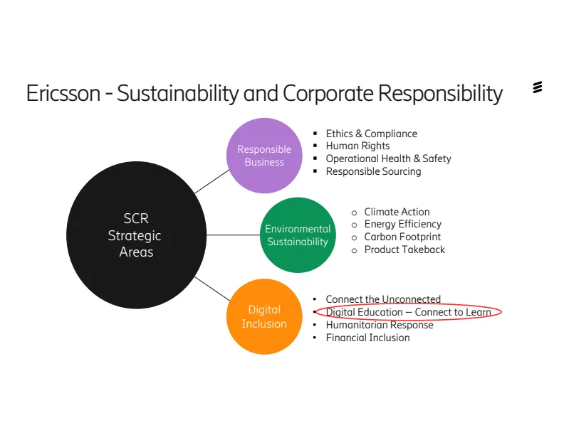

Ericsson - Sustainability and Corporate Responsibility  Ethics & Compliance  Human Rights  Operational Health & Safety  Responsible Sourcing
o Climate Action
o Energy Efficiency
o Carbon Footprint
o Product Takeback • Connect the Unconnected • Digital Education – Connect to Learn • Humanitarian Response • Financial Inclusion
SCR
Strategic 
Areas
Responsible
Business
Environmental
Sustainability
Digital 
Inclusion

## Slide 4 - `0811454811e2:4:5b065573`

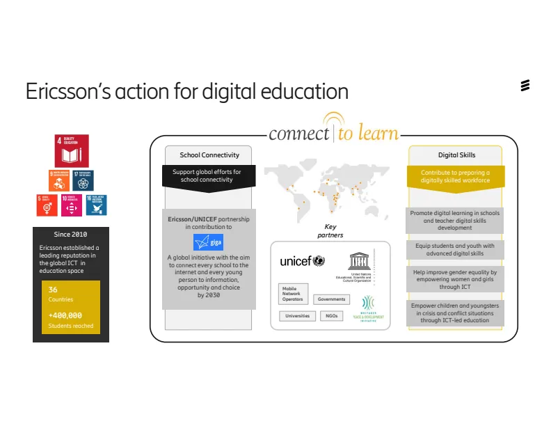

Ericsson’s action for digital education
Support global efforts for 
school connectivity
Empower children and youngsters 
in crisis and conflict situations 
through ICT-led education
Contribute to preparing a 
digitally skilled workforce
Help improve gender equality by 
empowering women and girls 
through ICT 36
Countries
+400,000
Students reached
Since 2010
Ericsson established a 
leading reputation in 
the global ICT in 
education space
School Connectivity Digital Skills
Ericsson/UNICEF partnership 
in contribution to 
A global initiative with the aim 
to connect every school to the 
internet and every young 
person to information, 
opportunity and choice
by 2030
Ericsson/UNICEF partnership 
in contribution to 
A global initiative with the aim 
to connect every school to the 
internet and every young 
person to information, 
opportunity and choice
by 2030
Key 
partners
Mobile 
Network 
Operators
Equip students and youth with 
advanced digital skills
Promote digital learning in schools 
and teacher digital skills 
development
Universities NGOs
Governments

## Slide 5 - `0811454811e2:5:2e6b10f9`

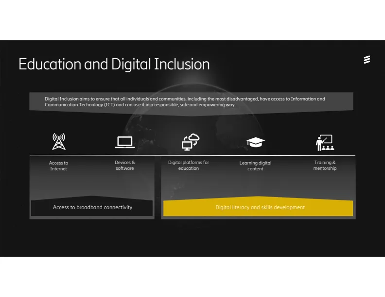

Education and Digital Inclusion
Digital Inclusion aims to ensure that all individuals and communities, including the most disadvantaged, have access to Information and 
Communication Technology (ICT) and can use it in a responsible, safe and empowering way.
Access to broadband connectivity Digital literacy and skills development
Access to 
Internet
Devices & 
software 
Learning digital 
content
Training & 
mentorship
Digital platforms for 
education

## Slide 6 - `0811454811e2:6:ff1b0cf4`

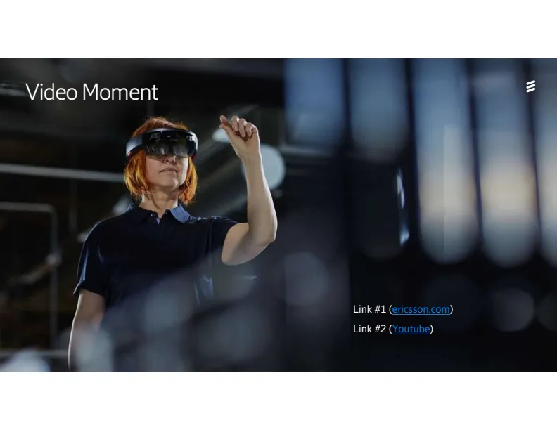

Video Moment
Link #1 (ericsson.com)
Link #2 (Youtube)

## Slide 7 - `0811454811e2:7:a4db202f`

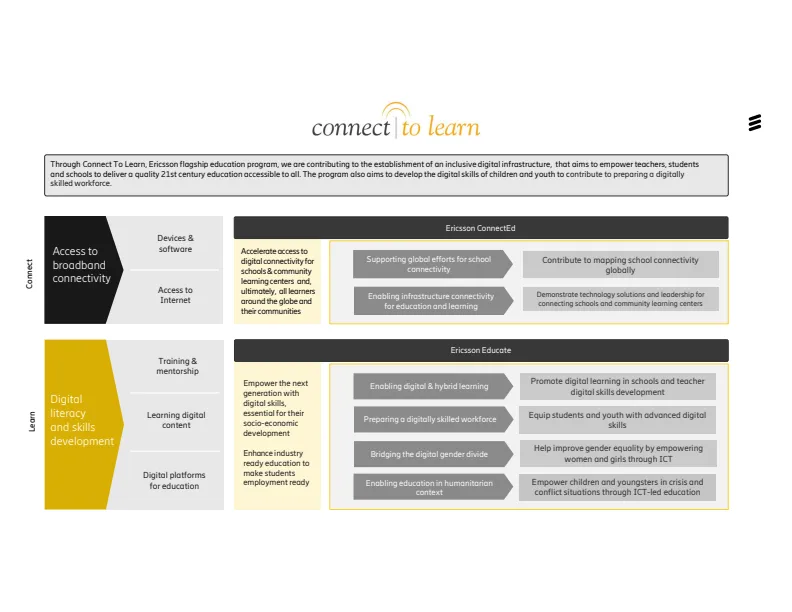

Digital 
literacy 
and skills 
development
Through Connect To Learn, Ericsson flagship education program, we are contributing to the establishment of an inclusive digital infrastructure, that aims to empower teachers, students 
and schools to deliver a quality 21st century education accessible to all. The program also aims to develop the digital skills of children and youth to contribute to preparing a digitally 
skilled workforce.
Learning digital 
content
Training & 
mentorship
Digital platforms 
for education
Ericsson Educate
Empower the next 
generation with 
digital skills, 
essential for their 
socio-economic 
development 
Enhance industry 
ready education to 
make students 
employment ready Empower children and youngsters in crisis and 
conflict situations through ICT-led education
Help improve gender equality by empowering 
women and girls through ICT
Equip students and youth with advanced digital 
skills
Promote digital learning in schools and teacher 
digital skills development
Bridging the digital gender divide
Enabling education in humanitarian 
context
Preparing a digitally skilled workforce
Enabling digital & hybrid learning Learn
Access to 
broadband 
connectivity
Access to 
Internet
Devices & 
software 
Ericsson ConnectEd
Accelerate access to 
digital connectivity for 
schools & community 
learning centers and, 
ultimately, all learners 
around the globe and 
their communities
Contribute to mapping school connectivity 
globally 
Supporting global efforts for school 
connectivity Connect
Demonstrate technology solutions and leadership for 
connecting schools and community learning centers Enabling infrastructure connectivity 
for education and learning

## Slide 8 - `0811454811e2:8:c9bc1939`

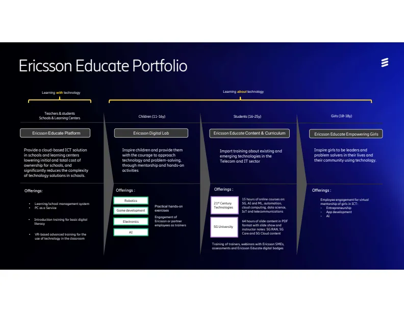

Ericsson Educate Portfolio
Provide a cloud-based ICT solution 
in schools and learning centers 
lowering initial and total cost of 
ownership for schools, and 
significantly reduces the complexity 
of technology solutions in schools.
Teachers & students
Schools & Learning Centers
Inspire children and provide them 
with the courage to approach 
technology and problem-solving, 
through mentorship and hands-on 
activities
Impart training about existing and 
emerging technologies in the 
Telecom and IT sector
Inspire girls to be leaders and 
problem solvers in their lives and 
their community using technology.
Children (11-16y) Students (16-25y) Girls (10-18y)
Ericsson Educate Platform Ericsson Digital Lab Ericsson Educate Content & Curriculum Ericsson Educate Empowering Girls
Learning with technology Learning about technology
21st Century 
Technologies
5G University
15 hours of online courses on: 
5G, AI and ML, automation, 
cloud computing, data science, 
IoT and telecommunications
64 hours of slide content in PDF 
format with slide show and 
instructor notes: 5G RAN, 5G 
Core and 5G Cloud content
Robotics
Game development
Electronics
AI
Practical hands-on 
exercises
Engagement of 
Ericsson or partner 
employees as trainers
Offerings :
Training of trainers, webinars with Ericsson SMEs, 
assessments and Ericsson Educate digital badges • Introduction training for basic digital 
literacy • VR-based advanced training for the 
use of technology in the classroom
• Learning/school management system
• PC as a Service
Employee engagement for virtual 
mentorship of girls in ICT:
- Entrepreneurship
- App development
- AI
Offerings: Offerings : Offerings :

## Slide 9 - `0811454811e2:9:311de69c`

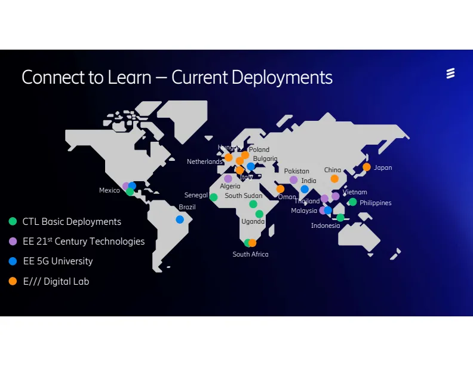

Connect to Learn – Current Deployments
CTL Basic Deployments
EE 21st Century Technologies
EE 5G University
E/// Digital Lab
Mexico
Brazil
South Africa
Senegal
Netherlands
Algeria
Malaysia
Indonesia
Philippines
Japan
Oman
Poland
Bulgaria
Hungary
Italy
Pakistan
India
China
Vietnam
Thailand South Sudan
Uganda

## Slide 10 - `0811454811e2:10:5a169648`

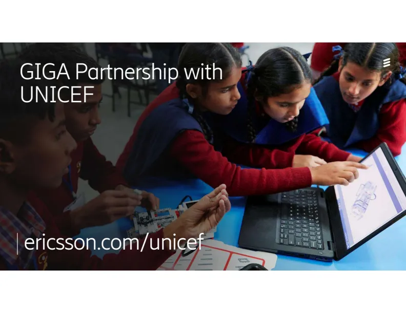

GIGA Partnership with 
UNICEF
ericsson.com/unicef

## Slide 11 - `0811454811e2:11:18774576`

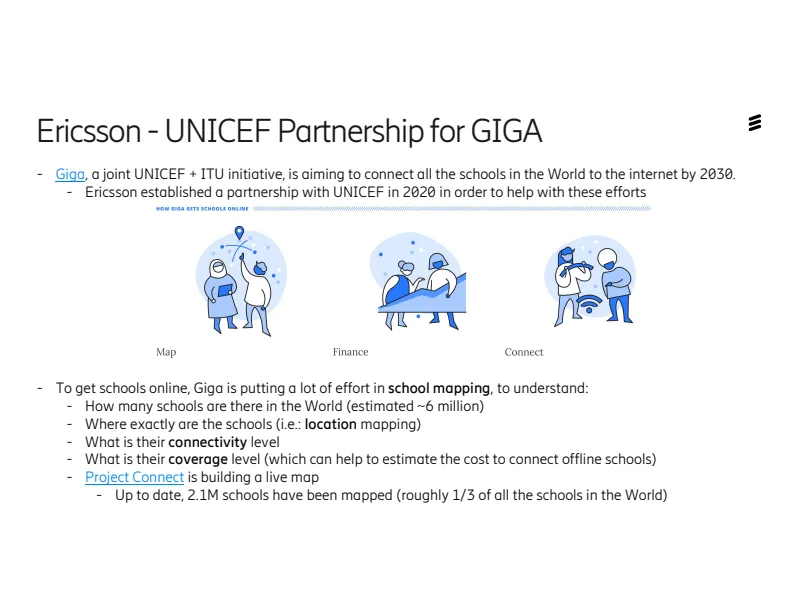

Ericsson - UNICEF Partnership for GIGA
- Giga, a joint UNICEF + ITU initiative, is aiming to connect all the schools in the World to the internet by 2030.
- Ericsson established a partnership with UNICEF in 2020 in order to help with these efforts 
- To get schools online, Giga is putting a lot of effort in school mapping, to understand:
- How many schools are there in the World (estimated ~6 million)
- Where exactly are the schools (i.e.: location mapping)
- What is their connectivity level
- What is their coverage level (which can help to estimate the cost to connect offline schools) - Project Connect is building a live map
- Up to date, 2.1M schools have been mapped (roughly 1/3 of all the schools in the World)

## Slide 12 - `0811454811e2:12:0771c366`

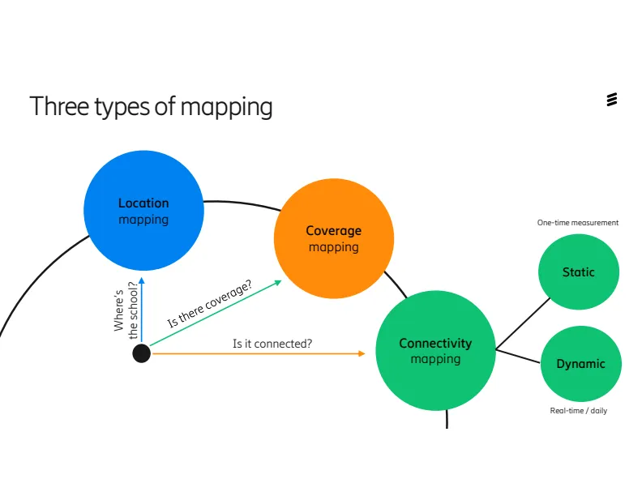

Three types of mapping Where’s the school? 
Is it connected?
Location
mapping Coverage
mapping
Connectivity
mapping
Static
Dynamic
One-time measurement
Real-time / daily

## Slide 13 - `0811454811e2:13:0405c4c8`

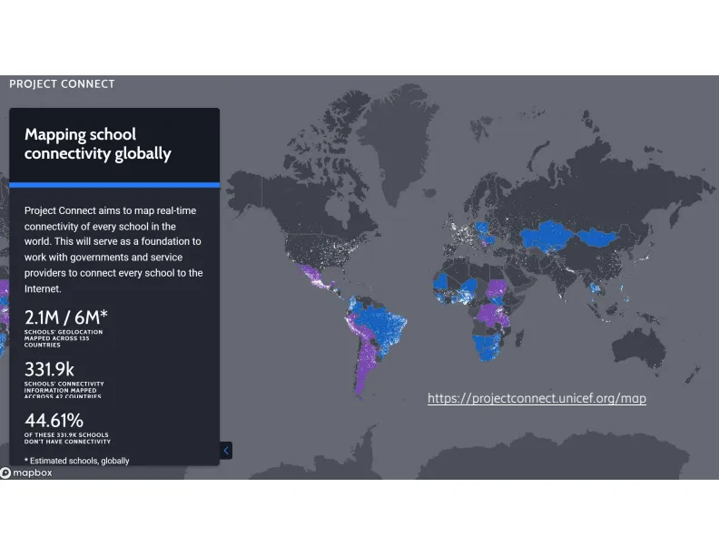

https://projectconnect.unicef.org/map

## Slide 14 - `0811454811e2:14:378215ca`

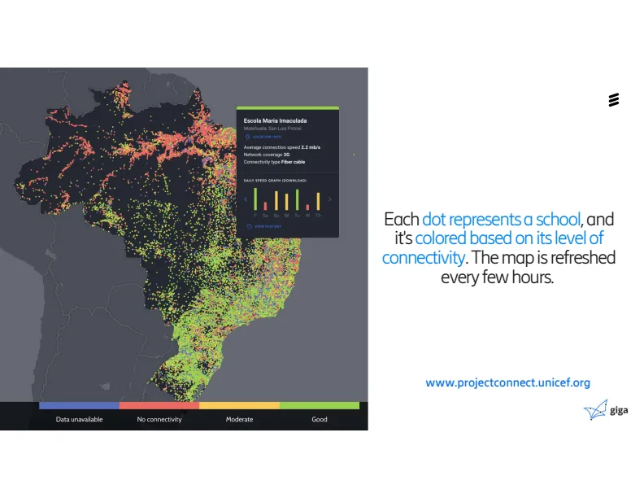

www.giga.global | info@gigaconnect.org
Each dot represents a school, and 
it's colored based on its level of 
connectivity. The map is refreshed 
every few hours.
www.projectconnect.unicef.org

## Slide 15 - `0811454811e2:15:9c3d38e9`

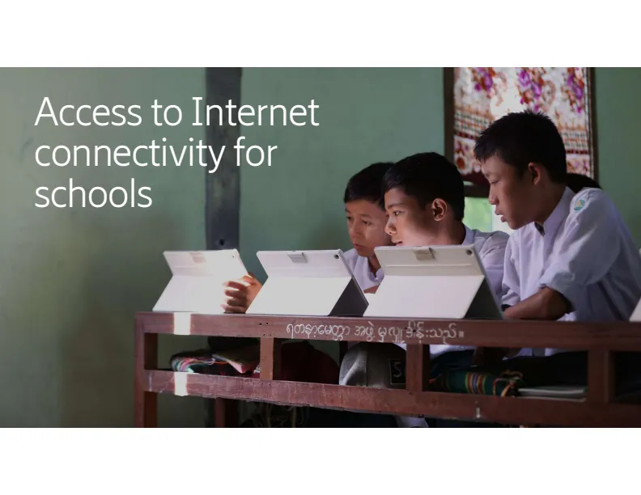

Access to Internet 
connectivity for 
schools

## Slide 16 - `0811454811e2:16:c375bda7`

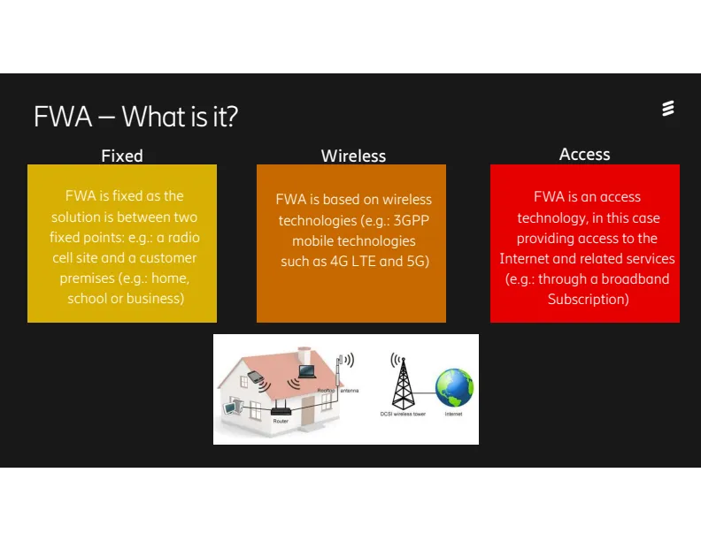

FWA – What is it?
FWA is an access
technology, in this case
providing access to the 
Internet and related services 
(e.g.: through a broadband 
Subscription)
Fixed Access
FWA is based on wireless 
technologies (e.g.: 3GPP 
mobile technologies 
such as 4G LTE and 5G)
Wireless
FWA is fixed as the 
solution is between two 
fixed points: e.g.: a radio 
cell site and a customer 
premises (e.g.: home, 
school or business)

## Slide 17 - `0811454811e2:17:0a32717b`

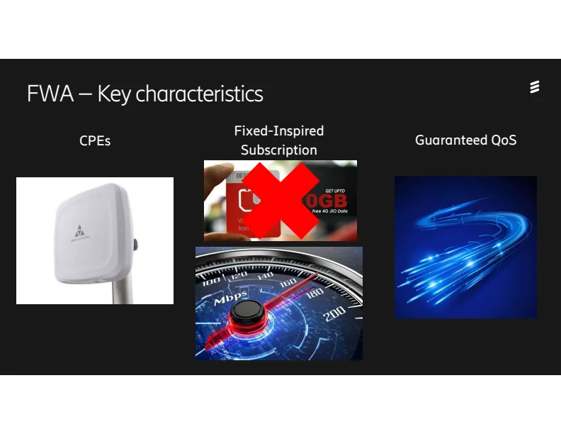

FWA – Key characteristics
CPEs Guaranteed QoS Fixed-Inspired
Subscription

## Slide 18 - `0811454811e2:18:2d580bfa`

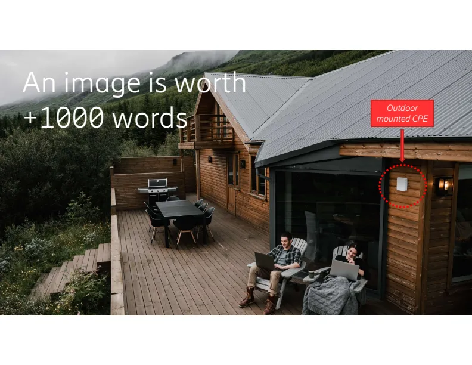

An image is worth
+1000 words Outdoor 
mounted CPE

## Slide 19 - `0811454811e2:19:127958f1`

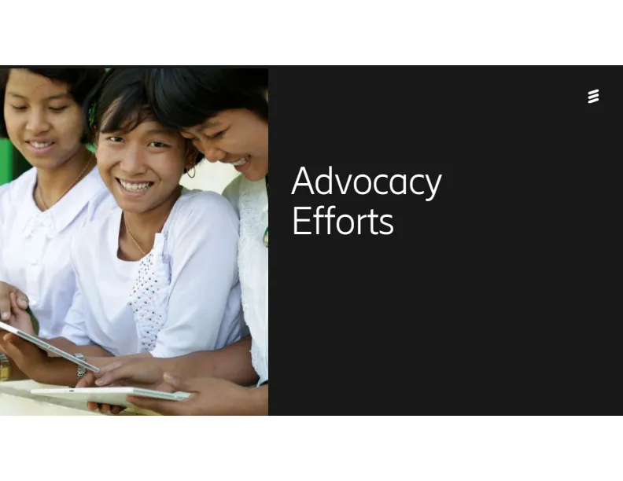

Advocacy 
Efforts

## Slide 20 - `0811454811e2:20:72998aa5`

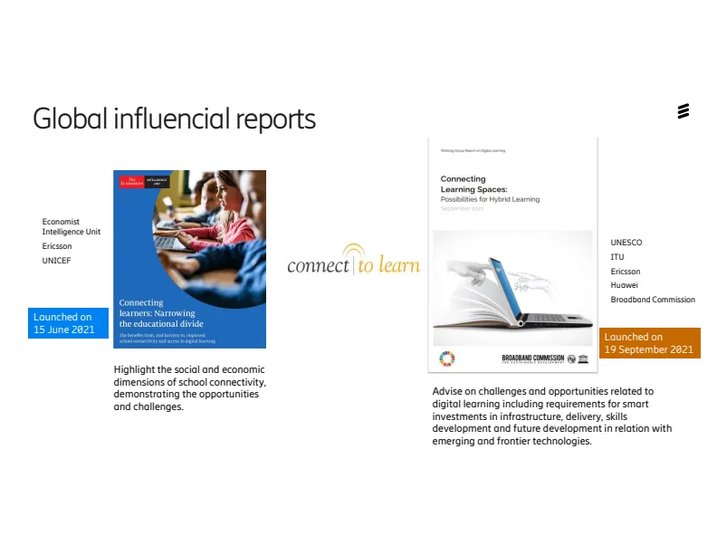

Global influencial reports
Advise on challenges and opportunities related to 
digital learning including requirements for smart 
investments in infrastructure, delivery, skills 
development and future development in relation with 
emerging and frontier technologies. 
Highlight the social and economic 
dimensions of school connectivity, 
demonstrating the opportunities 
and challenges. 
Economist 
Intelligence Unit
Ericsson 
UNICEF 
UNESCO
ITU
Ericsson
Huawei
Broadband Commission
Launched on 
19 September 2021 
Launched on 
15 June 2021

## Slide 21 - `0811454811e2:21:d0402480`

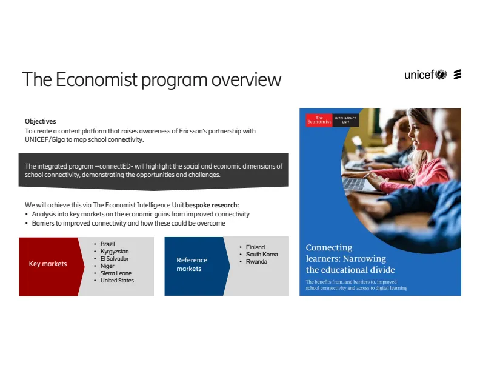

The Economist program overview
Objectives
To create a content platform that raises awareness of Ericsson’s partnership with 
UNICEF/Giga to map school connectivity.
The integrated program –connectED- will highlight the social and economic dimensions of 
school connectivity, demonstrating the opportunities and challenges.
We will achieve this via The Economist Intelligence Unit bespoke research:
● Analysis into key markets on the economic gains from improved connectivity
● Barriers to improved connectivity and how these could be overcome ● Brazil ● Kyrgyzstan
● El Salvador ● Niger
● Sierra Leone 
● United States
Key markets ● Finland
● South Korea
Reference ● Rwanda 
markets

## Slide 22 - `0811454811e2:22:49426a2c`

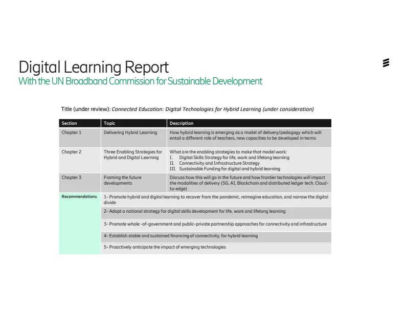

Digital Learning Report
With the UN Broadband Commission for Sustainable Development
Section Topic Description
Chapter 1 Delivering Hybrid Learning How hybrid learning is emerging as a model of delivery/pedagogy which will 
entail a different role of teachers, new capacities to be developed in terms 
Chapter 2 Three Enabling Strategies for 
Hybrid and Digital Learning
What are the enabling strategies to make that model work: 
I. Digital Skills Strategy for life, work and lifelong learning 
II. Connectivity and Infrastructure Strategy 
III. Sustainable Funding for digital and hybrid learning 
Chapter 3 Framing the future 
developments
Discuss how this will go in the future and how frontier technologies will impact 
the modalities of delivery (5G, AI, Blockchain and distributed ledger tech, Cloudto-edge)
Recommendations 1- Promote hybrid and digital learning to recover from the pandemic, reimagine education, and narrow the digital 
divide 
2- Adopt a national strategy for digital skills development for life, work and lifelong learning
3- Promote whole -of-government and public-private partnership approaches for connectivity and infrastructure
4- Establish stable and sustained financing of connectivity, for hybrid learning
5- Proactively anticipate the impact of emerging technologies
Title (under review): Connected Education: Digital Technologies for Hybrid Learning (under consideration)

## Slide 23 - `0811454811e2:23:6a6ba57a`

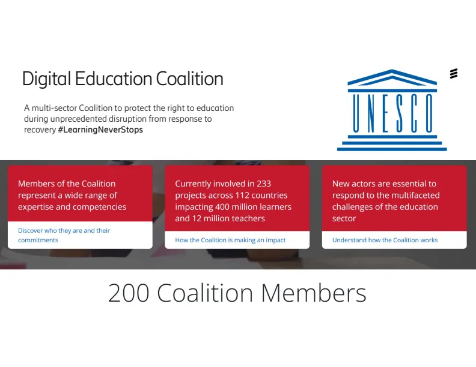

Digital Education Coalition
A multi-sector Coalition to protect the right to education 
during unprecedented disruption from response to 
recovery #LearningNeverStops

## Slide 24 - `0811454811e2:24:465beb1e`

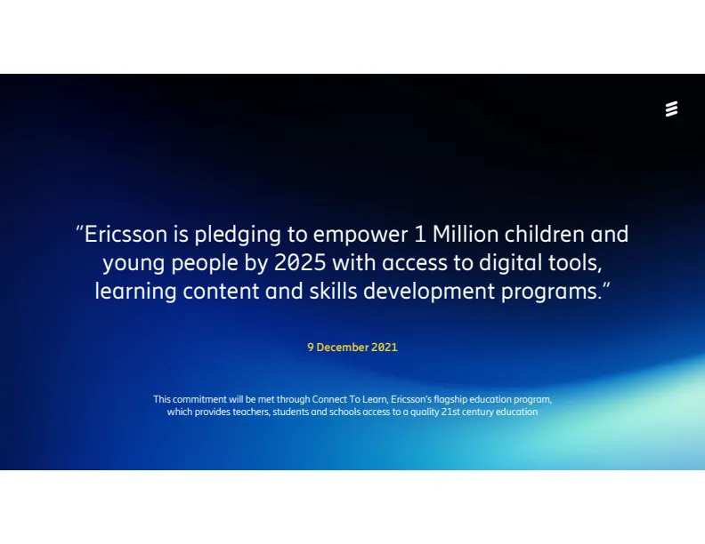

9 December 2021
This commitment will be met through Connect To Learn, Ericsson’s flagship education program, 
which provides teachers, students and schools access to a quality 21st century education
“Ericsson is pledging to empower 1 Million children and 
young people by 2025 with access to digital tools, 
learning content and skills development programs.”

## Slide 25 - `0811454811e2:25:424e6c5a`

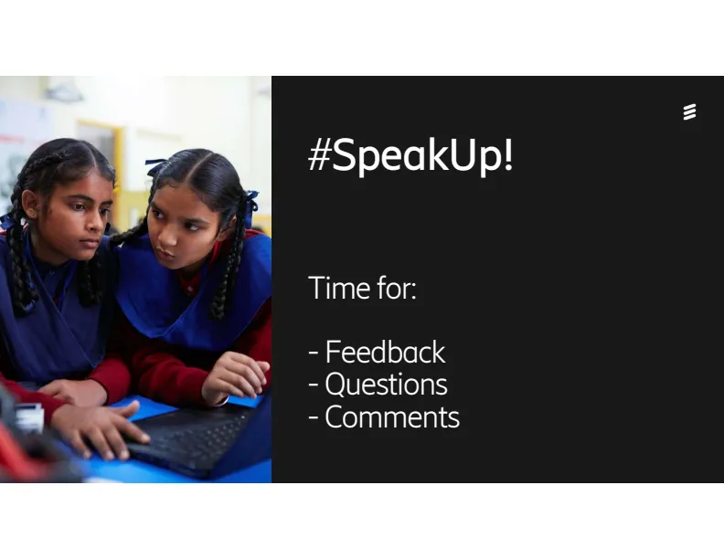

#SpeakUp!
Time for:
- Feedback
- Questions
- Comments

## Slide 26 - `0811454811e2:26:47386f46`

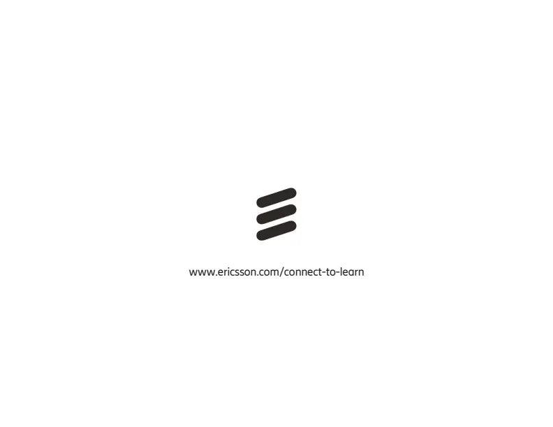

Characters for Embedded characters:
!"#$%&'()*+,./0123456789:;<=>?@ABCDEFGHIJKLMNOPQRSTUVWXYZ[\]^_`abcdefghijklmnopqrstuvwxyz{|}~¡¢£¤¥¦§¨©ª«¬®¯°±²³´¶·¸¹º»
¼½ÀÁÂÃÄÅÆÇÈËÌÍÎÏÐÑÒÓÔÕÖ×ØÙÚÛÜÝÞßàáâãäåæçèéêëìíîïðñòóôõö÷øùúûüýþÿĀāĂăąĆćĊċČĎďĐđĒĖėĘęĚěĞğĠġĢģĪīĮįİıĶķĹĺĻļĽľŁłŃńŅņŇ
ňŌŐőŒœŔŕŖŗŘřŚśŞşŠšŢţŤťŪūŮůŰűŲųŴŵŶŷŸŹźŻżŽžƒȘșˆˇ˘˙˚˛˜˝ẀẁẃẄẅỲỳ‘’‚“”„†‡•…‰‹›⁄€™ĀĀĂĂĄĄĆĆĊĊČČĎĎĐĐĒĒĖĖĘĘĚĚĞĞĠĠĢĢĪĪĮĮİĶ
ĶĹĹĻĻĽĽŃŃŅŅŇŇŌŌŐŐŔŔŖŖŘŘŚŚŞŞŢŢŤŤŪŪŮŮŰŰŲŲŴŴŶŶŹŹŻŻȘș−≤≥fiflΆΈΉΊΌΎΏΐΑΒΓΕΖΗΘΙΚΛΜΝΞΟΠΡΣΤΥΦΧΨΪΫΆΈΉΊΰαβγδεζηθικλ
νξορςΣΤΥΦΧΨΩΪΫΌΎΏЁЂЃЄЅІЇЈЉЊЋЌЎЏАБВГДЕЖЗИЙКЛМНОПРСТУФХЦЧШЩЪЫЬЭЮЯАБВГДЕЖЗИЙКЛМНОПРСТУФХЦЧШЩЪЫЬЭЮ
ЯЁЂЃЄЅІЇЈЉЊЋЌЎЏѢѢѲѲѴѴҐҐәǽẀẁẂẃẄẅỲỳ№—–-
!"#$%&'()*+,./0123456789:;<=>?@ABCDEFGHIJKLMNOPQRSTUVWXYZ[\]^_`abcdefghijklmnopqrstuvwxyz{|}~¡¢£¤¥¦§¨©ª«¬®¯°±²³´¶·¸¹
º»¼½ÀÁÂÃÄÅÆÇÈËÌÍÎÏÐÑÒÓÔÕÖ×ØÙÚÛÜÝÞßàáâãäåæçèéêëìíîïðñòóôõö÷øùúûüýþÿĀāĂăąĆćĊċČĎďĐđĒĖėĘęĚěĞğĠġĢģĪīĮįİıĶķĹĺĻļĽľŁł
ŃńŅņŇňŌŐőŒœŔŕŖŗŘřŚśŞşŠšŢţŤťŪūŮůŰűŲųŴŵŶŷŸŹźŻżŽžƒȘșˆˇ˘˙˚˛˜˝ẀẁẃẄẅỲỳ‘’‚“”„†‡•…‰‹›⁄€™ĀĀĂĂĄĄĆĆĊĊČČĎĎĐĐĒĒĖĖĘĘĚĚĞĞĠ
ĠĢĢĪĪĮĮİĶĶĹĹĻĻĽĽŃŃŅŅŇŇŌŌŐŐŔŔŖŖŘŘŚŚŞŞŢŢŤŤŪŪŮŮŰŰŲŲŴŴŶŶŹŹŻŻȘș−≤≥fiflΆΈΉΊΌΎΏΐΑΒΓΕΖΗΘΙΚΛΜΝΞΟΠΡΣΤΥΦΧΨΪΫΆΈΉ
ΊΰαβγδεζηθικλνξορςΣΤΥΦΧΨΩΪΫΌΎΏЁЂЃЄЅІЇЈЉЊЋЌЎЏАБВГДЕЖЗИЙКЛМНОПРСТУФХЦЧШЩЪЫЬЭЮЯАБВГДЕЖЗИЙКЛМНОПРСТУ
ФХЦЧШЩЪЫЬЭЮЯЁЂЃЄЅІЇЈЉЊЋЌЎЏѢѢѲѲѴѴҐҐәǽẀẁẂẃẄẅỲỳ№—–-
!"#$%&'()*+,./0123456789:;<=>?@ABCDEFGHIJKLMNOPQRSTUVWXYZ[\]^_`abcdefghijklmnopqrstuvwxyz{|}~¡¢£¤¥¦§¨©ª«¬®¯°±²³´¶·¸¹º»¼
½ÀÁÂÃÄÅÆÇÈËÌÍÎÏÐÑÒÓÔÕÖ×ØÙÚÛÜÝÞßàáâãäåæçèéêëìíîïðñòóôõö÷øùúûüýþÿĀāĂăąĆćĊċČĎďĐđĒĖėĘęĚěĞğĠġĢģĪīĮįİıĶķĹĺĻļĽľŁłŃńŅņŇňŌŐ
őŒœŔŕŖŗŘřŚśŞşŠšŢţŤťŪūŮůŰűŲųŴŵŶŷŸŹźŻżŽžƒȘșˆˇ˘˙˚˛˜˝ẀẁẃẄẅỲỳ‘’‚“”„†‡•…‰‹›⁄€™ĀĀĂĂĄĄĆĆĊĊČČĎĎĐĐĒĒĖĖĘĘĚĚĞĞĠĠĢĢĪĪĮĮİĶĶĹĹĻĻĽ
ĽŃŃŅŅŇŇŌŌŐŐŔŔŖŖŘŘŚŚŞŞŢŢŤŤŪŪŮŮŰŰŲŲŴŴŶŶŹŹŻŻȘș−≤≥fiflΆΈΉΊΌΎΏΐΑΒΓΕΖΗΘΙΚΛΜΝΞΟΠΡΣΤΥΦΧΨΪΫΆΈΉΊΰαβγδεζηθικλνξορςΣΤΥ
ΦΧΨΩΪΫΌΎΏЁЂЃЄЅІЇЈЉЊЋЌЎЏАБВГДЕЖЗИЙКЛМНОПРСТУФХЦЧШЩЪЫЬЭЮЯАБВГДЕЖЗИЙКЛМНОПРСТУФХЦЧШЩЪЫЬЭЮЯЁЂЃЄЅІЇЈ
ЉЊЋЌЎЏѢѢѲѲѴѴҐҐәǽẀẁẂẃẄẅỲỳ№—–-
!"#$%&'()*+,./0123456789:;<=>?@ABCDEFGHIJKLMNOPQRSTUVWXYZ[\]^_`abcdefghijklmnopqrstuvwxyz{|}~¡¢£¤¥¦§¨©ª«¬®¯°±²³´¶·¸¹º»
¼½ÀÁÂÃÄÅÆÇÈËÌÍÎÏÐÑÒÓÔÕÖ×ØÙÚÛÜÝÞßàáâãäåæçèéêëìíîïðñòóôõö÷øùúûüýþÿĀāĂăąĆćĊċČĎďĐđĒĖėĘęĚěĞğĠġĢģĪīĮįİıĶķĹĺĻļĽľŁłŃńŅ
ņŇňŌŐőŒœŔŕŖŗŘřŚśŞşŠšŢţŤťŪūŮůŰűŲųŴŵŶŷŸŹźŻżŽžƒȘșˆˇ˘˙˚˛˜˝ẀẁẃẄẅỲỳ‘’‚“”„†‡•…‰‹›⁄€™ĀĀĂĂĄĄĆĆĊĊČČĎĎĐĐĒĒĖĖĘĘĚĚĞĞĠĠĢĢĪĪ
ĮĮİĶĶĹĹĻĻĽĽŃŃŅŅŇŇŌŌŐŐŔŔŖŖŘŘŚŚŞŞŢŢŤŤŪŪŮŮŰŰŲŲŴŴŶŶŹŹŻŻȘș−≤≥fiflΆΈΉΊΌΎΏΐΑΒΓΕΖΗΘΙΚΛΜΝΞΟΠΡΣΤΥΦΧΨΪΫΆΈΉΊΰαβγδε
ζηθικλνξορςΣΤΥΦΧΨΩΪΫΌΎΏЁЂЃЄЅІЇЈЉЊЋЌЎЏАБВГДЕЖЗИЙКЛМНОПРСТУФХЦЧШЩЪЫЬЭЮЯАБВГДЕЖЗИЙКЛМНОПРСТУФХЦЧШЩ
ЪЫЬЭЮЯЁЂЃЄЅІЇЈЉЊЋЌЎЏѢѢѲѲѴѴҐҐәǽẀẁẂẃẄẅỲỳ№—–-
www.ericsson.com/connect-to-learn
