# GraalVMs_Ahead-of-Time_Compilation_(Source).mp4

- Duration: 16:00
- Key frames: 16, transcript segments: 235
- Source: local, SHA-256 `56788476f81d23dab45cde7bbf89a6f537ca1d31951567e512845690d3dd46c8`

## 00:00

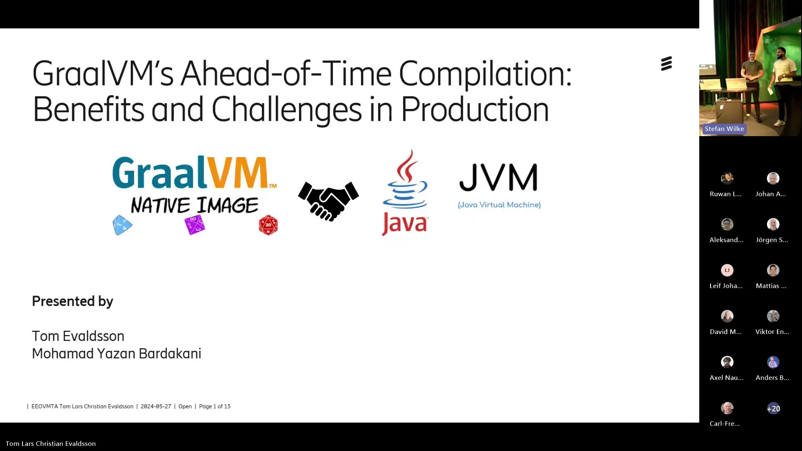

- **[00:00] Speaker ?:** Thank you.
- **[00:01] Speaker ?:** Hello and welcome to our thesis presentation.
- **[00:05] Speaker ?:** We're going to talk about grow VMs ahead of time, compilation, benefits and challenges
- **[00:11] Speaker ?:** in production.
- **[00:12] Speaker ?:** It will be presented by me, Mohamed Ezan Baratakhani and me, Tommy Watson.

## 00:19

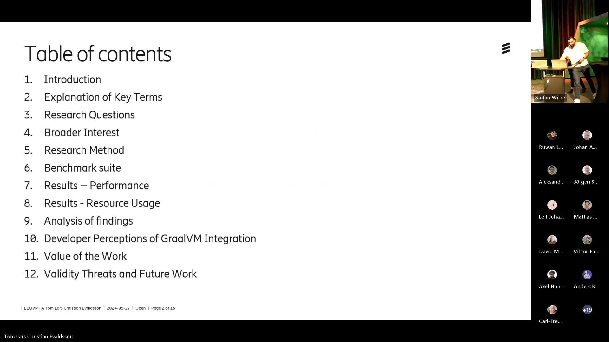

- **[00:19] Speaker ?:** Here is the table of content that we're going to talk about.

## 00:26

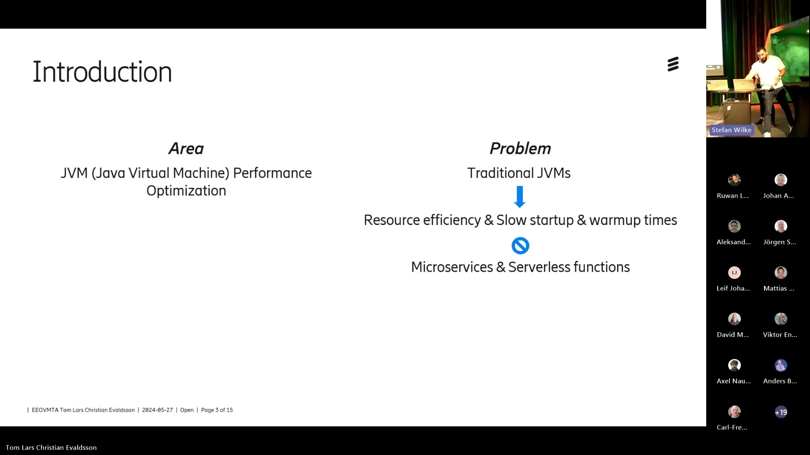

- **[00:28] Speaker ?:** As you know, Java-based application faced challenges in a contentized environment.
- **[00:35] Speaker ?:** And these challenges include the inefficient resource usage and slow startup time,
- **[00:41] Speaker ?:** which affects operational sustainability and efficiency,
- **[00:47] Speaker ?:** and the grow VM address Java JVMs limitation
- **[00:52] Speaker ?:** and offering low resource consumption and faster startup time.
- **[00:57] Speaker ?:** And it's good in cloud computing and microservices environment
- **[01:04] Speaker ?:** where rapid scaling and cost-effective resource consumption are critical.
- **[01:10] Speaker ?:** And the primary objective of this thesis is to critically examine the capabilities of grow VMs.
- **[01:21] Speaker ?:** Mainly focusing on its ahead-of-time, completion and native image support.
- **[01:27] Speaker ?:** Here are some key terms that we need to explain.

## 01:30

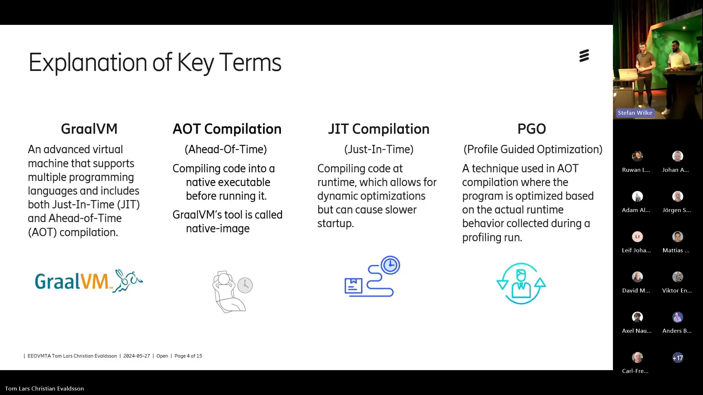

- **[01:33] Speaker ?:** So grow VM is a project by Oracle, which is basically a copy of the hotspot JVM.
- **[01:42] Speaker ?:** But it's also included features like just-in-time compilation,
- **[01:46] Speaker ?:** or a more optimized just-in-time compilation,
- **[01:50] Speaker ?:** and the ability to ahead-of-time compile,
- **[01:54] Speaker ?:** and also running multiple languages on the same app.
- **[01:58] Speaker ?:** So ahead-of-time compilation is compiling code into a native executable
- **[02:04] Speaker ?:** that can run only on the target platform.
- **[02:10] Speaker ?:** And the grow VMs tool for this is native image.
- **[02:15] Speaker ?:** And just-in-time compilation is compiling code at runtime,
- **[02:19] Speaker ?:** which is what the standard JVM uses.
- **[02:23] Speaker ?:** And then PGO, or profile-guided optimization,
- **[02:27] Speaker ?:** is a technique used in ahead-of-time compilation
- **[02:31] Speaker ?:** because to optimize in a good way, you need more information.
- **[02:38] Speaker ?:** So PGO is a way to create profiles of the application
- **[02:42] Speaker ?:** and optimize from those profiles.
- **[02:45] Speaker ?:** Yes, and here is our resource question where the first one,

## 02:47

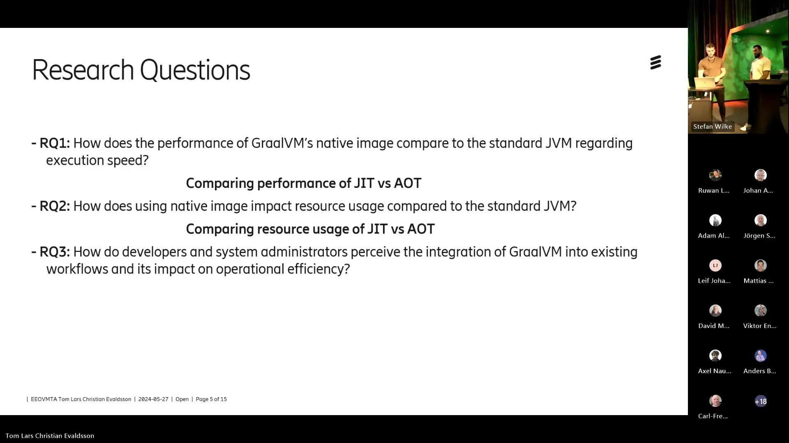

- **[02:51] Speaker ?:** how does the performance of a grow VMs native image
- **[02:54] Speaker ?:** compare to the standard JVM regarding execution speed?
- **[02:59] Speaker ?:** And this is compared just-in-time and ahead-of-time compilation.
- **[03:04] Speaker ?:** And the second one, how does native image impact resource usage
- **[03:08] Speaker ?:** compared to the standard JVM?
- **[03:11] Speaker ?:** And the last one, how do developers and the system administrator
- **[03:15] Speaker ?:** receive the integration of the grow VM
- **[03:18] Speaker ?:** ahead-of-time compilation into existing workflow
- **[03:22] Speaker ?:** and its impact on operational efficiency?
- **[03:26] Speaker ?:** And our research questions are based on the article
- **[03:30] Speaker ?:** that claims many things about grow VM ahead-of-time,
- **[03:35] Speaker ?:** improved performance and improved resource usage,
- **[03:39] Speaker ?:** and it's production ready.

## 03:43

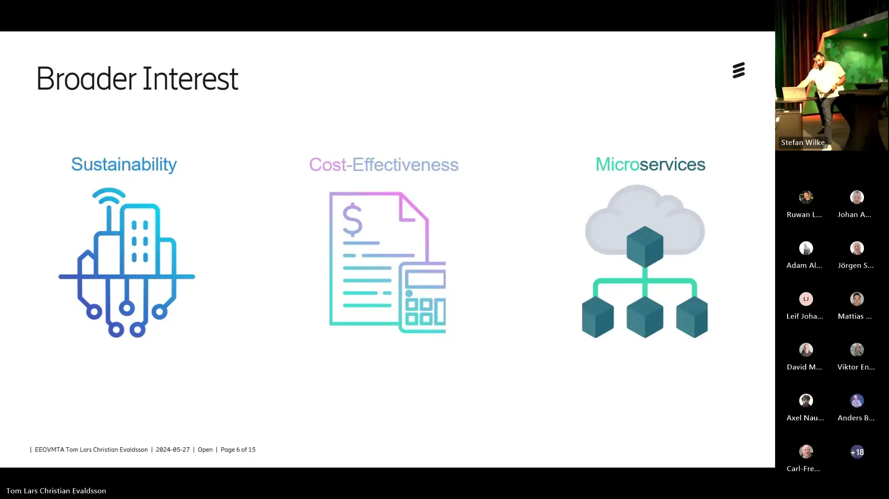

- **[03:44] Speaker ?:** And for the broader interest,
- **[03:46] Speaker ?:** so grow VMs helps in reducing the environmental impact
- **[03:50] Speaker ?:** by making application run more efficiently
- **[03:54] Speaker ?:** and with efficiently mean that it uses just
- **[03:57] Speaker ?:** the necessary resources and services like classes and methods.
- **[04:02] Speaker ?:** And it will be consuming less energy
- **[04:07] Speaker ?:** and optimized resource utilization
- **[04:11] Speaker ?:** lead to lower operational cost and saving money
- **[04:15] Speaker ?:** on infrastructure and energy pills.
- **[04:18] Speaker ?:** And the grow VM is practically
- **[04:21] Speaker ?:** particularly beneficial for microservices architecture
- **[04:26] Speaker ?:** and improved startup times and resource efficiency,
- **[04:31] Speaker ?:** which are critical, crucial for scalable
- **[04:36] Speaker ?:** and responsive applications.

## 04:40

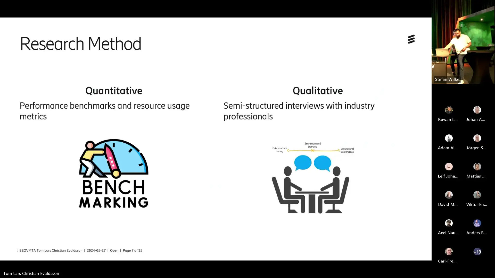

- **[04:41] Speaker ?:** And our resource methodology is the first one,
- **[04:45] Speaker ?:** quantitative data collection and qualitative data collection.
- **[04:50] Speaker ?:** So we use the performance benchmarks
- **[04:53] Speaker ?:** and the resource users' metrics
- **[04:56] Speaker ?:** to provide the price and the objective data
- **[04:59] Speaker ?:** on how different JVM configuration versus standard
- **[05:04] Speaker ?:** versus grow VMs prefer.
- **[05:06] Speaker ?:** And it will highlight the performance improvement
- **[05:12] Speaker ?:** or regulations.
- **[05:15] Speaker ?:** And for the qualitative data collection
- **[05:18] Speaker ?:** we use the semi-structured interviews
- **[05:21] Speaker ?:** where it's an offer in depth on understanding
- **[05:26] Speaker ?:** the practical challenges and benefits
- **[05:29] Speaker ?:** of integration grow VM into existing workflow
- **[05:34] Speaker ?:** and this type of open-ended questions
- **[05:37] Speaker ?:** will allow informants to the flexibility
- **[05:41] Speaker ?:** to share their views in their own words.
- **[05:44] Speaker ?:** So the benchmark suite we decided on

## 05:48

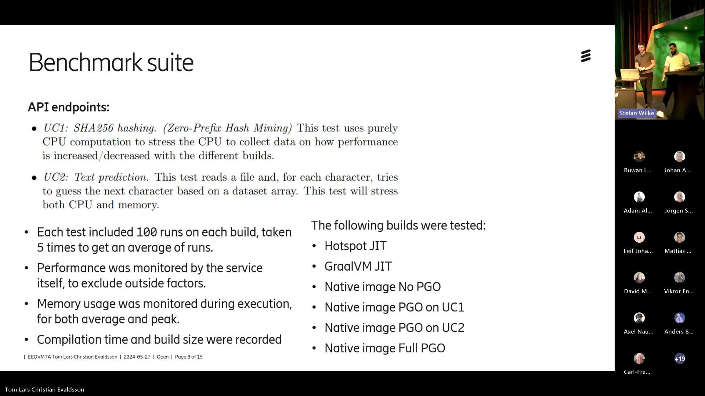

- **[05:50] Speaker ?:** was to use two use cases to test an application.
- **[05:55] Speaker ?:** The first use case we used was zero prefix hashing,
- **[05:58] Speaker ?:** which is a very CPU heavy use case.
- **[06:02] Speaker ?:** And then the second use case was text prediction algorithm
- **[06:08] Speaker ?:** which uses a large dataset to predict text,
- **[06:12] Speaker ?:** which is both CPU and memory intensive.
- **[06:16] Speaker ?:** Each test was run 100 times
- **[06:19] Speaker ?:** to get an accurate picture of both the stability
- **[06:24] Speaker ?:** of the performance and to be able to see
- **[06:29] Speaker ?:** the startup and warm-up times for the JVMs.
- **[06:34] Speaker ?:** Performance was monitored internally,
- **[06:37] Speaker ?:** but we tested them through API endpoints
- **[06:42] Speaker ?:** to make it easier to test.
- **[06:46] Speaker ?:** And then we also measured memory usage,
- **[06:48] Speaker ?:** both average and peak.
- **[06:51] Speaker ?:** And we also recorded compilation and build time
- **[06:55] Speaker ?:** or compilation time and build size.
- **[06:58] Speaker ?:** So the builds we compared were the normal hotspots
- **[07:03] Speaker ?:** just in time, the Gravium optimized just in time,
- **[07:07] Speaker ?:** and then for native images,
- **[07:10] Speaker ?:** one that had no profiled optimization,
- **[07:14] Speaker ?:** one that had on use case one,
- **[07:17] Speaker ?:** one that had PGO on use case two,
- **[07:19] Speaker ?:** and one that had full PGO.

## 07:24

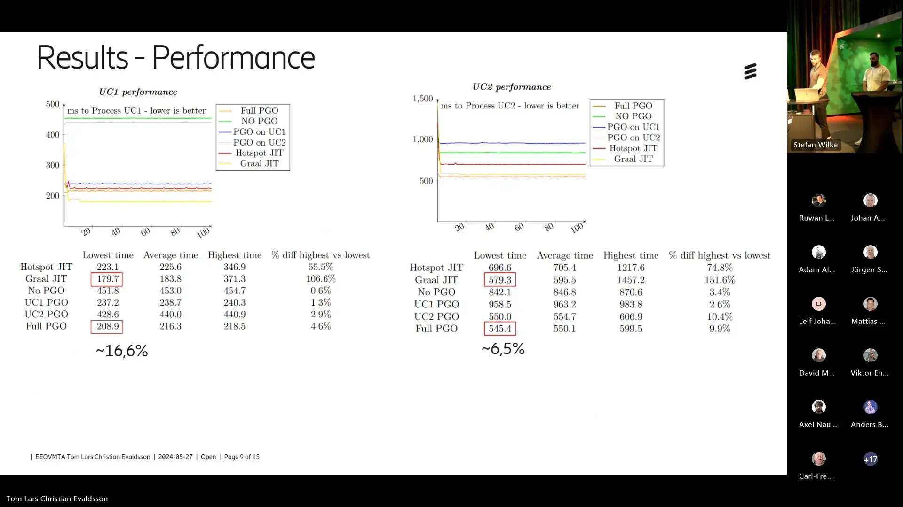

- **[07:24] Speaker ?:** So here we can see from the graphs
- **[07:28] Speaker ?:** that we can see on the yellow and red lines
- **[07:33] Speaker ?:** that those are just in times,
- **[07:37] Speaker ?:** and they start up very high, very slow,
- **[07:42] Speaker ?:** and then once they warm up,
- **[07:44] Speaker ?:** they settle into a very good performance position.
- **[07:48] Speaker ?:** And we can see on the left that the Gravium just in time
- **[07:53] Speaker ?:** outperformed the full PGO,
- **[07:56] Speaker ?:** which is the fastest of the native images
- **[08:00] Speaker ?:** by about 16%.
- **[08:02] Speaker ?:** And we can see on the right that the native image
- **[08:06] Speaker ?:** actually outperformed the Gravium just in time,
- **[08:09] Speaker ?:** which was the fastest of the just in times.
- **[08:13] Speaker ?:** So we can see here that it really depends on the use case
- **[08:17] Speaker ?:** if native image can improve performance or not,
- **[08:20] Speaker ?:** but when it comes to the first few executions,
- **[08:25] Speaker ?:** it can be a lot faster.
- **[08:28] Speaker ?:** We can also see that PGO increases the performance by a lot
- **[08:33] Speaker ?:** in both use cases.
- **[08:36] Speaker ?:** When not using PGO,
- **[08:38] Speaker ?:** execution took about 1.8 to 2 times slower.

## 08:45

## 08:46

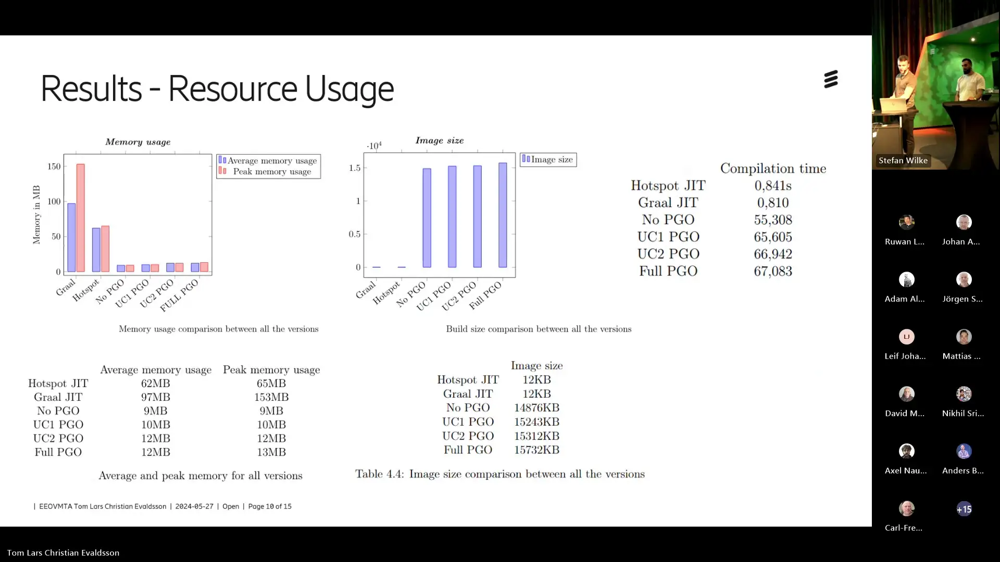

- **[08:46] Speaker ?:** And then we can see here,
- **[08:48] Speaker ?:** we can start with memory usage.
- **[08:50] Speaker ?:** The just in times were used a lot of memory.
- **[08:54] Speaker ?:** We can also see that Grav just in time used more memory,
- **[08:58] Speaker ?:** which is probably because of its more aggressive optimization
- **[09:01] Speaker ?:** and sacrificing memory to get better performance.
- **[09:05] Speaker ?:** And we can also see that the native images
- **[09:09] Speaker ?:** are pretty good in memory usage,
- **[09:12] Speaker ?:** but we can see that the more PGO you use,
- **[09:15] Speaker ?:** the more memory it uses.
- **[09:17] Speaker ?:** And we can see that the Grav just in time
- **[09:20] Speaker ?:** has a lot of peak memory usage,
- **[09:22] Speaker ?:** which was during the warm up,
- **[09:24] Speaker ?:** but then it settled in and stuck around the 100 mark
- **[09:30] Speaker ?:** during execution.
- **[09:32] Speaker ?:** And we can also see in the build size
- **[09:34] Speaker ?:** that just in times are much better on build size.
- **[09:38] Speaker ?:** It's much smaller than the native images,
- **[09:41] Speaker ?:** which were a lot bigger
- **[09:43] Speaker ?:** because they contain a lot more information
- **[09:45] Speaker ?:** and they contain the native code to execute.
- **[09:51] Speaker ?:** And we can see in compilation time
- **[09:53] Speaker ?:** that the native images are a lot slower to compile,
- **[09:57] Speaker ?:** even though this is a very small image.
- **[10:01] Speaker ?:** And the native images will never be faster
- **[10:06] Speaker ?:** because you first have to compile to a jar
- **[10:09] Speaker ?:** and then do the native image step.
- **[10:12] Speaker ?:** So it would always be slower than just compiling for adjusting time.

## 10:19

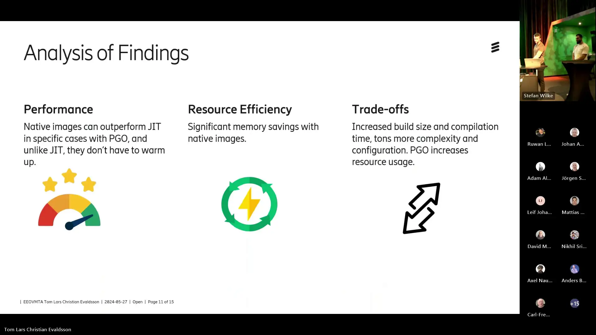

- **[10:19] Speaker ?:** Yes, analysis of findings.
- **[10:22] Speaker ?:** So for the performance native image
- **[10:24] Speaker ?:** can out from just in time in specific cases
- **[10:27] Speaker ?:** with PGO and online developer display spectrum

## 11:00

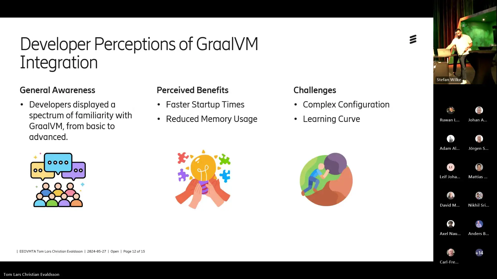

- **[11:12] Speaker ?:** of family tree with the Graal VM
- **[11:15] Speaker ?:** from basic to advanced and perceived benefits.
- **[11:19] Speaker ?:** So faster startup time.
- **[11:21] Speaker ?:** This is especially for application
- **[11:23] Speaker ?:** that need quick responsive like serverless functions
- **[11:28] Speaker ?:** and reduced memory usage
- **[11:31] Speaker ?:** where it's important for microservices
- **[11:34] Speaker ?:** that run in resource constrained environment
- **[11:38] Speaker ?:** and for the challenges they thought.
- **[11:42] Speaker ?:** So complex configuration.
- **[11:45] Speaker ?:** It requires significant efforts
- **[11:47] Speaker ?:** to configure for dynamic future like reflections
- **[11:51] Speaker ?:** and for the learning curve.
- **[11:53] Speaker ?:** So developers need to train
- **[11:56] Speaker ?:** to effectively use ahead of time compilation and PGO.

## 12:04

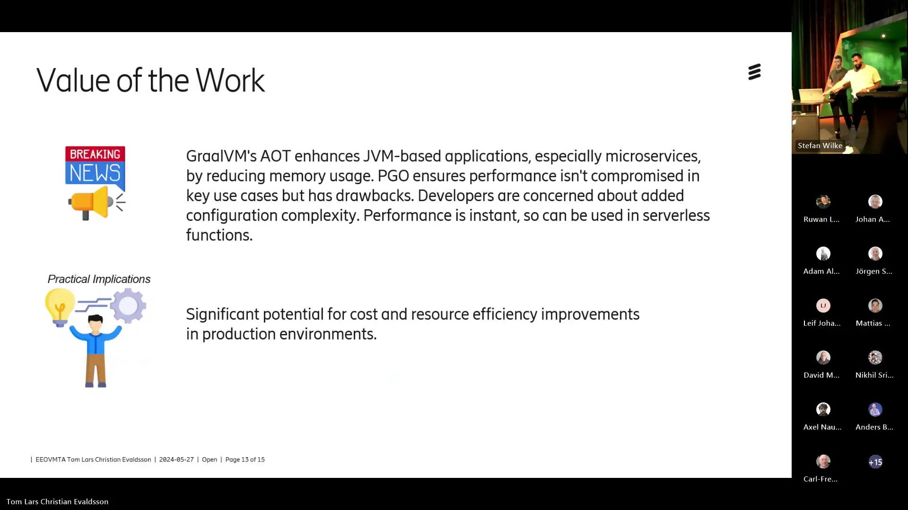

- **[12:04] Speaker ?:** So the value of our work
- **[12:06] Speaker ?:** is that Graal VMs ahead of time
- **[12:09] Speaker ?:** enhances JVM based applications
- **[12:12] Speaker ?:** especially by reducing memory usage
- **[12:15] Speaker ?:** which is important in microservices.
- **[12:18] Speaker ?:** PGO also ensures that performance isn't
- **[12:23] Speaker ?:** much worse in key use cases
- **[12:26] Speaker ?:** and sometimes better
- **[12:28] Speaker ?:** but it has drawbacks such as increasing memory
- **[12:31] Speaker ?:** increasing compilation time
- **[12:33] Speaker ?:** and increasing image size.
- **[12:36] Speaker ?:** And developers are concerned
- **[12:38] Speaker ?:** about the added configuration complexity.
- **[12:42] Speaker ?:** We can also note that performance is instant
- **[12:45] Speaker ?:** there is no warm up needed
- **[12:47] Speaker ?:** so they can be good for serverless functions
- **[12:53] Speaker ?:** and there is also a significant potential
- **[12:56] Speaker ?:** for cost and resource efficiency improvements
- **[13:00] Speaker ?:** in production environments.
- **[13:02] Speaker ?:** Yes, for the validity threats and future work

## 13:06

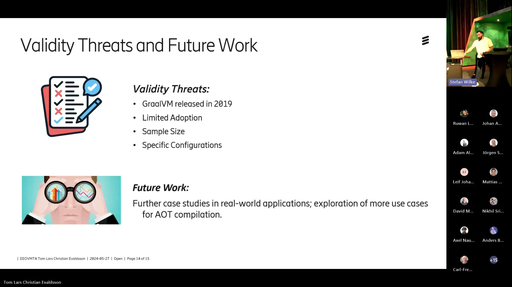

- **[13:09] Speaker ?:** so validity threats we thought
- **[13:13] Speaker ?:** that Graal VMs was released in 2019
- **[13:17] Speaker ?:** making it's a little bit new in the industry
- **[13:22] Speaker ?:** because it's a new technologies
- **[13:25] Speaker ?:** not many companies and developers
- **[13:28] Speaker ?:** have used it extensively
- **[13:31] Speaker ?:** so due to its limited adoption
- **[13:35] Speaker ?:** we had a small sample size of developers
- **[13:38] Speaker ?:** with hands-on experience using Graal VM
- **[13:42] Speaker ?:** and these results are specific
- **[13:46] Speaker ?:** to our software configuration used in our study
- **[13:50] Speaker ?:** so browser testing is needed
- **[13:54] Speaker ?:** to validate findings in varied environments.
- **[13:58] Speaker ?:** And then for future work
- **[14:01] Speaker ?:** we think that a good next step
- **[14:05] Speaker ?:** would be case studies
- **[14:07] Speaker ?:** on real-world applications
- **[14:09] Speaker ?:** to see how the performance
- **[14:11] Speaker ?:** and resource usage can be
- **[14:15] Speaker ?:** is affected by using ahead of time
- **[14:18] Speaker ?:** completion and also explore more use cases
- **[14:22] Speaker ?:** for ahead-of-time completion.
- **[14:24] Speaker ?:** Yes, thank you for listening

## 14:28

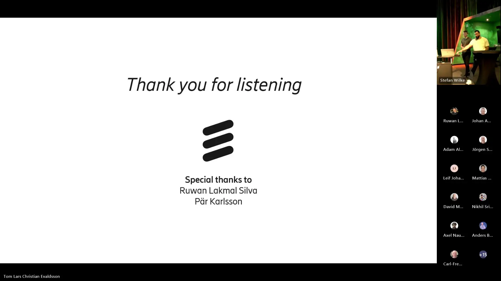

- **[14:29] Speaker ?:** and a special thanks for Lakmal and Park.
- **[14:34] Speaker ?:** Nice, thank you
- **[14:37] Speaker ?:** and a big applause for that.
- **[14:40] Speaker ?:** And do we have any questions
- **[14:45] Speaker ?:** in the audience or online, Lakmal?
- **[14:48] Speaker ?:** I think you started off with one of the
- **[15:01] Speaker ?:** Aida services, I wonder what happened to that track
- **[15:04] Speaker ?:** and what problems you encountered there?
- **[15:07] Speaker ?:** Yes, so during that track
- **[15:12] Speaker ?:** we got a build
- **[15:15] Speaker ?:** we compiled to a build
- **[15:18] Speaker ?:** and we set up a test environment
- **[15:20] Speaker ?:** but we have not gotten any tests
- **[15:23] Speaker ?:** to actually work
- **[15:25] Speaker ?:** it seems like the image is not really working
- **[15:28] Speaker ?:** so we have spent a lot of time trying to debug that
- **[15:33] Speaker ?:** but none of the things we have tried is working
- **[15:39] Speaker ?:** so we don't really know what to do
- **[15:44] Speaker ?:** so it was very hard to incorporate
- **[15:47] Speaker ?:** in production environments
- **[15:49] Speaker ?:** we thought.
- **[15:55] Speaker ?:** Any questions?
- **[15:56] Speaker ?:** Thanks again.
