# Ericsson Response Introduction[64]  -  Read-Only.pdf

- Slides: 19
- Source: local, SHA-256 `a0ce9da497f54799f1377cc0143ae4e8023725d46a843aca7e8823bff64272da`

## Slide 1 - `a0ce9da497f5:1:230d0be7`

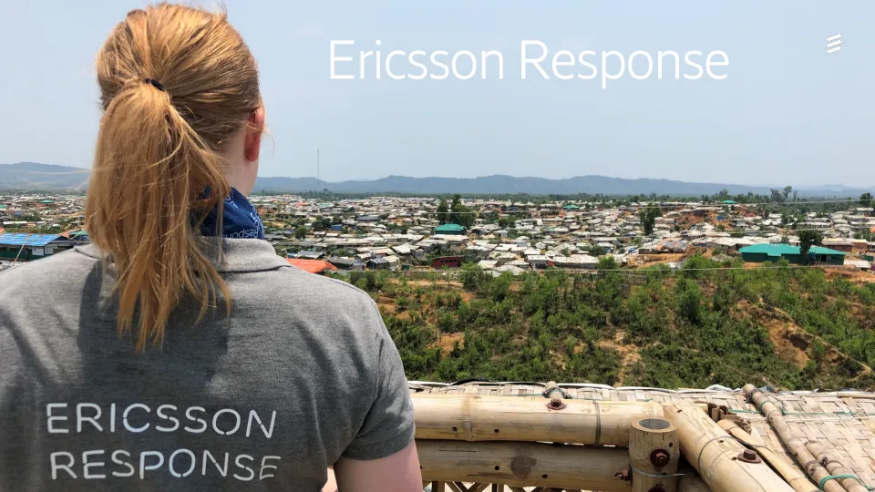

Ericsson Internal | 2018-02-21
Ericsson Response

## Slide 2 - `a0ce9da497f5:2:1b016b75`

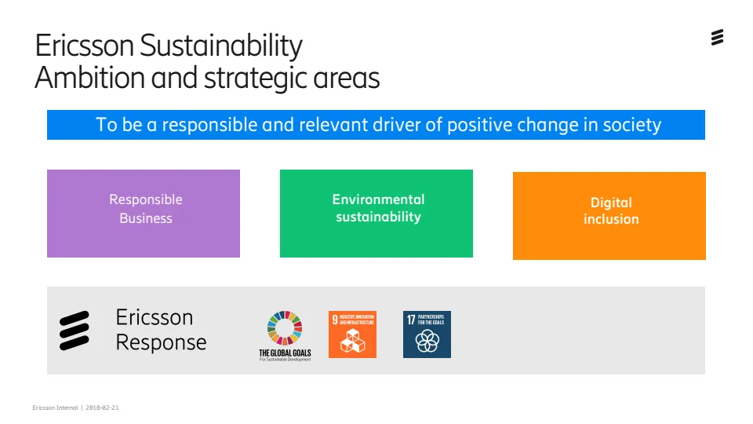

Ericsson Internal | 2018-02-21
Ericsson Sustainability
Ambition and strategic areas
Responsible 
Business
Environmental
sustainability
Digital 
inclusion
To be a responsible and relevant driver of positive change in society

## Slide 3 - `a0ce9da497f5:3:1655f564`

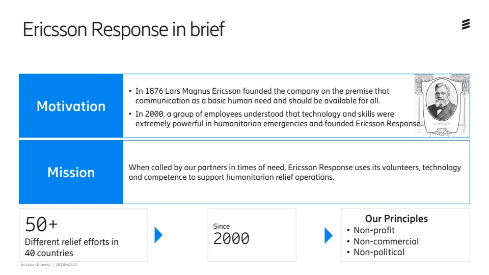

Ericsson Internal | 2018-02-21
Ericsson Response in brief
Motivation
Mission
• In 1876 Lars Magnus Ericsson founded the company on the premise that
communication as a basic human need and should be available for all.
• In 2000, a group of employees understood that technology and skills were
extremely powerful in humanitarian emergencies and founded Ericsson Response.
When called by our partners in times of need, Ericsson Response uses its volunteers, technology
and competence to support humanitarian relief operations.
50+
Different relief efforts in
40 countries
Our Principles
• Non-profit
• Non-commercial
• Non-political
Since
2000

## Slide 4 - `a0ce9da497f5:4:8adf7a9b`

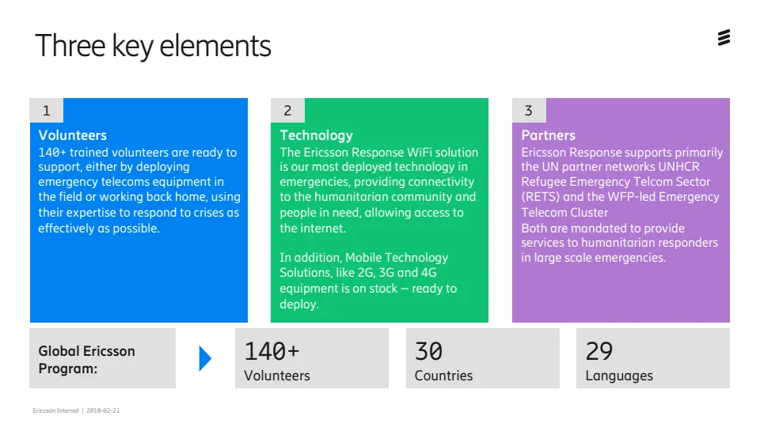

Ericsson Internal | 2018-02-21
Three key elements
Volunteers
140+ trained volunteers are ready to 
support, either by deploying 
emergency telecoms equipment in 
the field or working back home, using 
their expertise to respond to crises as 
effectively as possible. 
Technology
The Ericsson Response WiFi solution
is our most deployed technology in 
emergencies, providing connectivity
to the humanitarian community and 
people in need, allowing access to 
the internet. 
In addition, Mobile Technology 
Solutions, like 2G, 3G and 4G
equipment is on stock – ready to
deploy.
Partners
Ericsson Response supports primarily 
the UN partner networks UNHCR 
Refugee Emergency Telcom Sector 
(RETS) and the WFP-led Emergency 
Telecom Cluster
Both are mandated to provide
services to humanitarian responders
in large scale emergencies.
1 2 3
29 
Languages
Global Ericsson
Program:
30 
Countries
140+ 
Volunteers

## Slide 5 - `a0ce9da497f5:5:a3f3eb99`

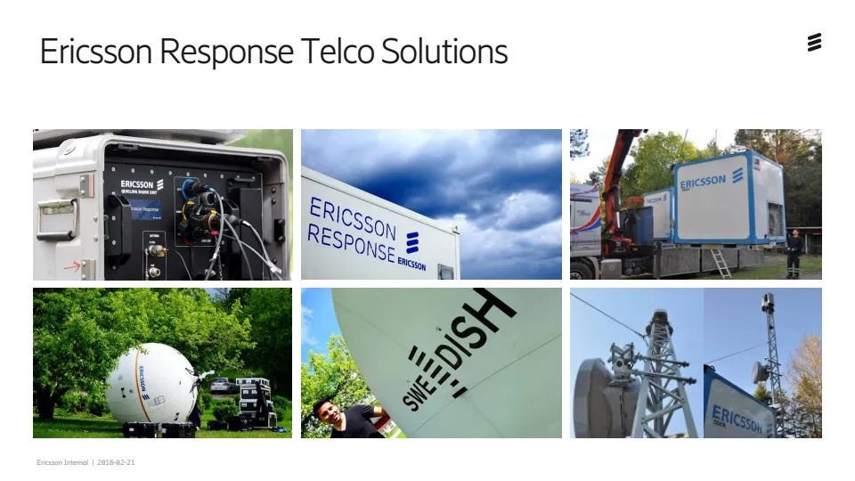

Ericsson Internal | 2018-02-21
Ericsson Response Telco Solutions
QuickLink

## Slide 6 - `a0ce9da497f5:6:8e918313`

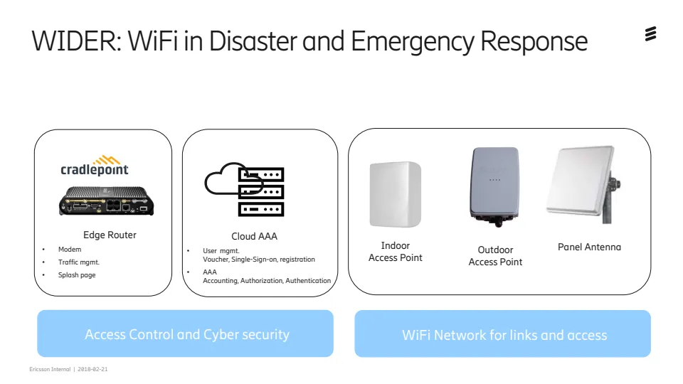

Ericsson Internal | 2018-02-21
WIDER: WiFi in Disaster and Emergency Response
Edge Router
• Modem
• Traffic mgmt.
• Splash page
Outdoor
Access Point
Indoor
Access Point
Panel Antenna
Cloud AAA
• User mgmt.
Voucher, Single-Sign-on, registration
• AAA 
Accounting, Authorization, Authentication
Access Control and Cyber security WiFi Network for links and access

## Slide 7 - `a0ce9da497f5:7:2f580155`

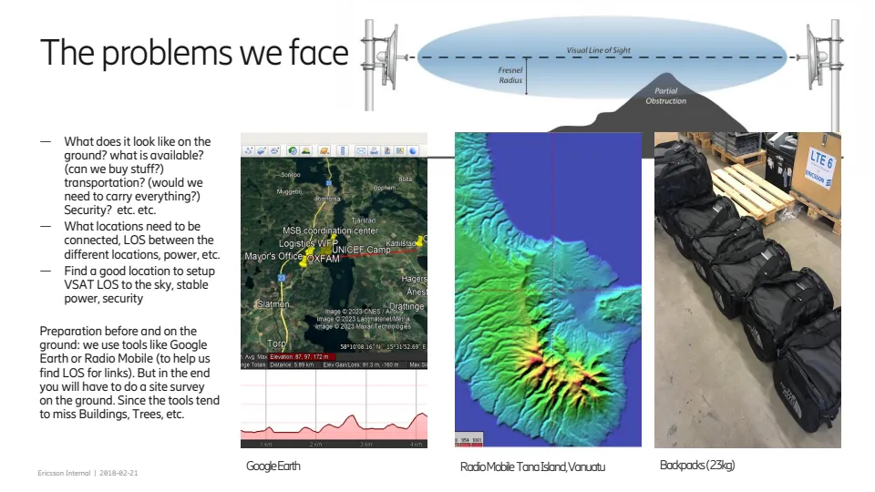

Ericsson Internal | 2018-02-21
— What does it look like on the 
ground? what is available? 
(can we buy stuff?) 
transportation? (would we 
need to carry everything?) 
Security? etc. etc.
— What locations need to be 
connected, LOS between the 
different locations, power, etc.
— Find a good location to setup 
VSAT LOS to the sky, stable 
power, security
Preparation before and on the 
ground: we use tools like Google 
Earth or Radio Mobile (to help us 
find LOS for links). But in the end 
you will have to do a site survey 
on the ground. Since the tools tend 
to miss Buildings, Trees, etc.
The problems we face
Google Earth Radio Mobile Tana Island, Vanuatu Backpacks ( 23kg)

## Slide 8 - `a0ce9da497f5:8:2f3584fa`

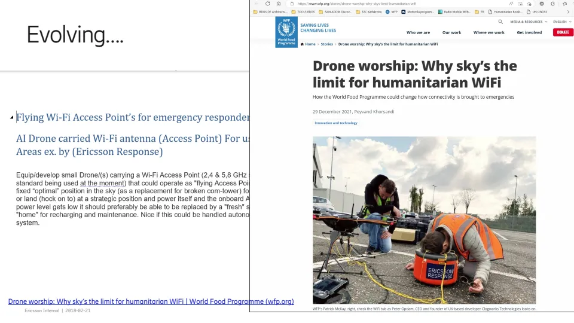

Ericsson Internal | 2018-02-21
Drone worship: Why sky’s the limit for humanitarian WiFi | World Food Programme (wfp.org)
Evolving….

## Slide 9 - `a0ce9da497f5:9:7b6b860a`

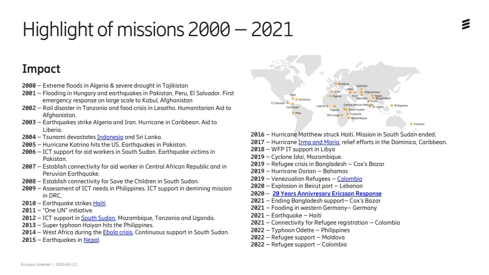

Ericsson Internal | 2018-02-21
Highlight of missions 2000 –2021
2000 – Extreme floods in Algeria & severe drought in Tajikistan
2001 – Flooding in Hungary and earthquakes in Pakistan, Peru, El Salvador. First 
emergency response on large scale to Kabul, Afghanistan
2002 – Rail disaster in Tanzania and food crisis in Lesotho. Humanitarian Aid to 
Afghanistan. 
2003 – Earthquakes strike Algeria and Iran. Hurricane in Caribbean. Aid to 
Liberia. 
2004 – Tsunami devastates Indonesia and Sri Lanka.
2005 – Hurricane Katrina hits the US. Earthquakes in Pakistan.
2006 – ICT support for aid workers in South Sudan. Earthquake victims in 
Pakistan.
2007 – Establish connectivity for aid worker in Central African Republic and in 
Peruvian Earthquake. 
2008 – Establish connectivity for Save the Children in South Sudan.
2009 – Assessment of ICT needs in Philippines. ICT support in demining mission 
in DRC.
2010 – Earthquake strikes Haiti.
2011 – ”One UN” initiative.
2012 – ICT support in South Sudan, Mozambique, Tanzania and Uganda.
2013 – Super typhoon Haiyan hits the Philippines.
2014 – West Africa during the Ebola crisis. Continuous support in South Sudan.
2015 – Earthquakes in Nepal. 
2016 – Hurricane Matthew struck Haiti. Mission in South Sudan ended. 
2017 – Hurricane Irma and Maria, relief efforts in the Dominica, Caribbean. 
2018 – WFP IT support in Libya
2019 – Cyclone Idai, Mozambique.
2019 – Refugee crisis in Bangladesh – Cox’s Bazar
2019 – Hurricane Dorian – Bahamas
2019 – Venezualian Refugees – Colombia
2020 – Explosion in Beirut port – Lebanon
2020 – 20 Years Annivresary Ericsson Response
2021 – Ending Bangladesh support– Cox’s Bazar
2021 – Fooding in western Germany– Germany
2021 – Earthquake – Haiti
2021 – Connectivity for Refugee registration – Colombia
2022 – Typhoon Odette – Philippines
2022 – Refugee support – Moldova
2022 – Refugee support – Colombia
Impact

## Slide 10 - `a0ce9da497f5:10:08efcdb3`

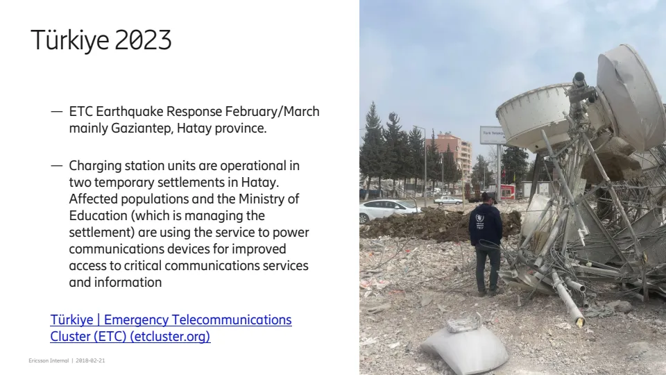

Ericsson Internal | 2018-02-21
— ETC Earthquake Response February/March 
mainly Gaziantep, Hatay province.
— Charging station units are operational in 
two temporary settlements in Hatay. 
Affected populations and the Ministry of 
Education (which is managing the 
settlement) are using the service to power 
communications devices for improved 
access to critical communications services 
and information
Türkiye | Emergency Telecommunications 
Cluster (ETC) (etcluster.org)
Türkiye 2023

## Slide 11 - `a0ce9da497f5:11:5c664158`

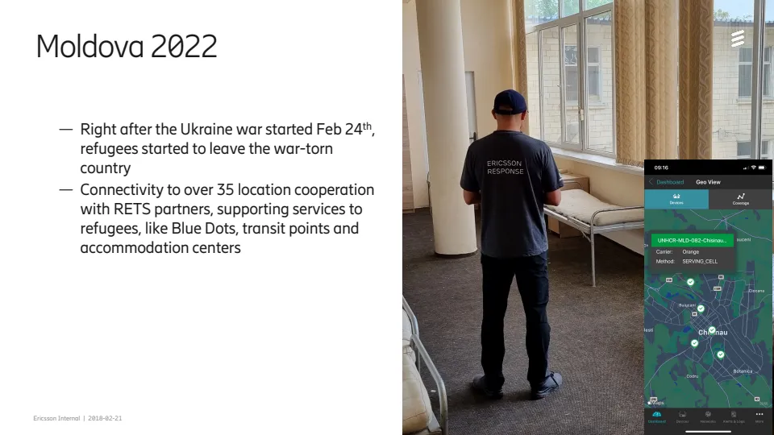

Ericsson Internal | 2018-02-21
— Right after the Ukraine war started Feb 24th, 
refugees started to leave the war-torn 
country
— Connectivity to over 35 location cooperation 
with RETS partners, supporting services to 
refugees, like Blue Dots, transit points and 
accommodation centers
Moldova 2022

## Slide 12 - `a0ce9da497f5:12:1fb51f01`

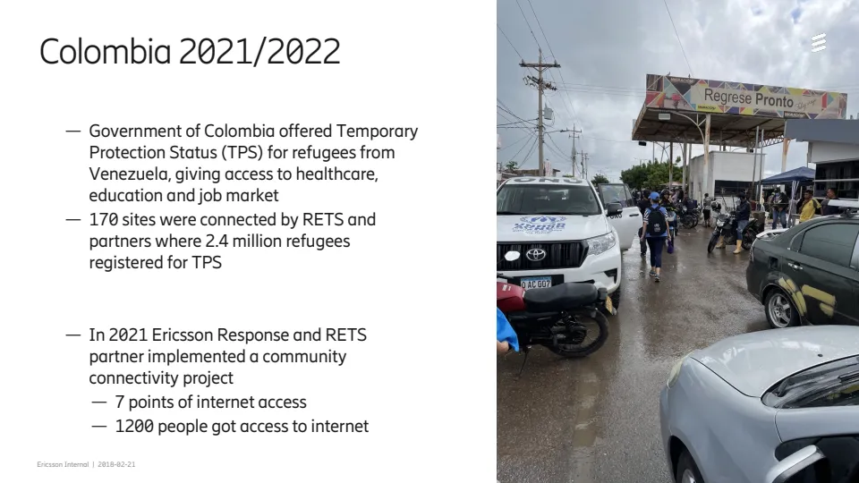

Ericsson Internal | 2018-02-21
— Government of Colombia offered Temporary 
Protection Status (TPS) for refugees from 
Venezuela, giving access to healthcare, 
education and job market
— 170 sites were connected by RETS and 
partners where 2.4 million refugees 
registered for TPS
— In 2021 Ericsson Response and RETS 
partner implemented a community 
connectivity project
— 7 points of internet access
— 1200 people got access to internet
Colombia 2021/2022

## Slide 13 - `a0ce9da497f5:13:1e1d370f`

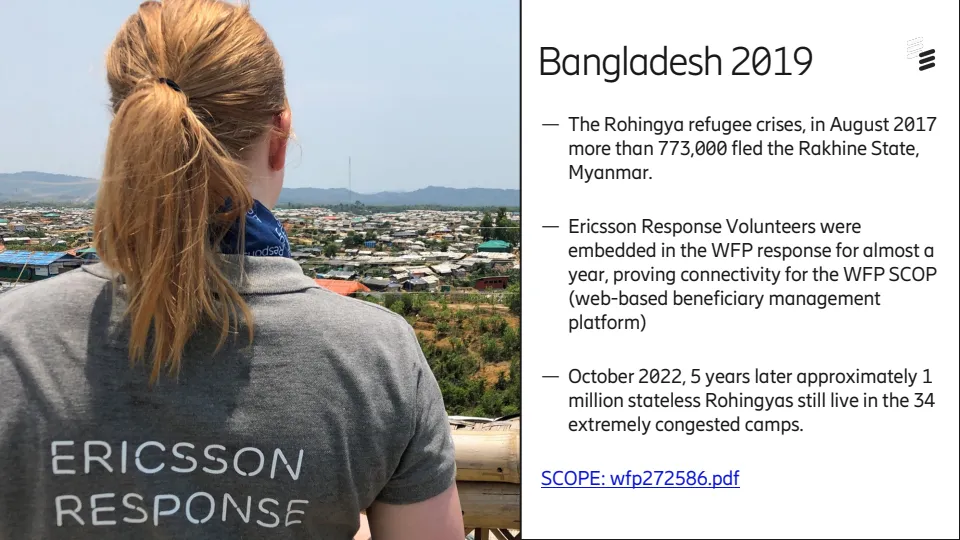

Ericsson Internal | 2018-02-21
— The Rohingya refugee crises, in August 2017 
more than 773,000 fled the Rakhine State, 
Myanmar. 
— Ericsson Response Volunteers were 
embedded in the WFP response for almost a 
year, proving connectivity for the WFP SCOP 
(web-based beneficiary management 
platform)
— October 2022, 5 years later approximately 1 
million stateless Rohingyas still live in the 34 
extremely congested camps. 
SCOPE: wfp272586.pdf
Bangladesh 2019

## Slide 14 - `a0ce9da497f5:14:66a9af91`

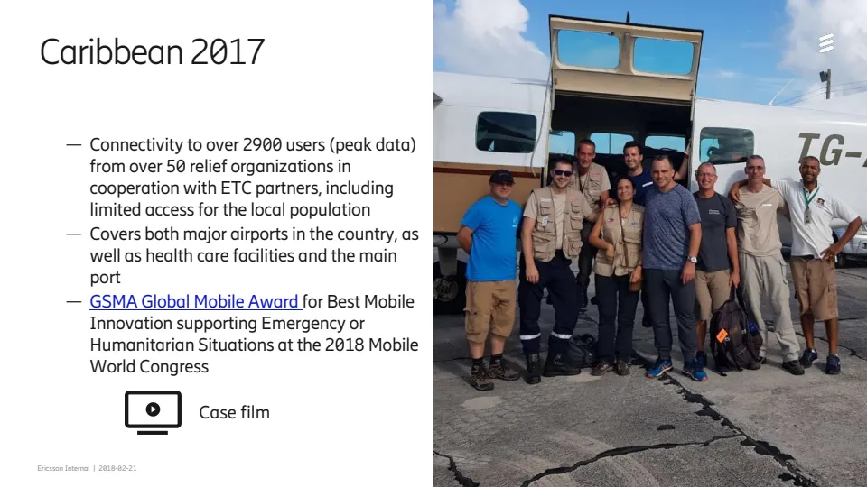

Ericsson Internal | 2018-02-21
— Connectivity to over 2900 users (peak data) 
from over 50 relief organizations in 
cooperation with ETC partners, including 
limited access for the local population
— Covers both major airports in the country, as 
well as health care facilities and the main 
port
— GSMA Global Mobile Award for Best Mobile 
Innovation supporting Emergency or 
Humanitarian Situations at the 2018 Mobile 
World Congress 
Caribbean 2017
Case film

## Slide 15 - `a0ce9da497f5:15:14f3254b`

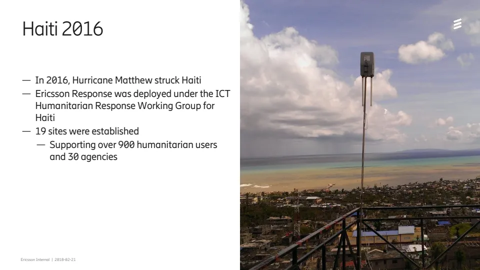

Ericsson Internal | 2018-02-21
— In 2016, Hurricane Matthew struck Haiti
— Ericsson Response was deployed under the ICT 
Humanitarian Response Working Group for 
Haiti
— 19 sites were established
— Supporting over 900 humanitarian users 
and 30 agencies
Haiti 2016

## Slide 16 - `a0ce9da497f5:16:291b20a7`

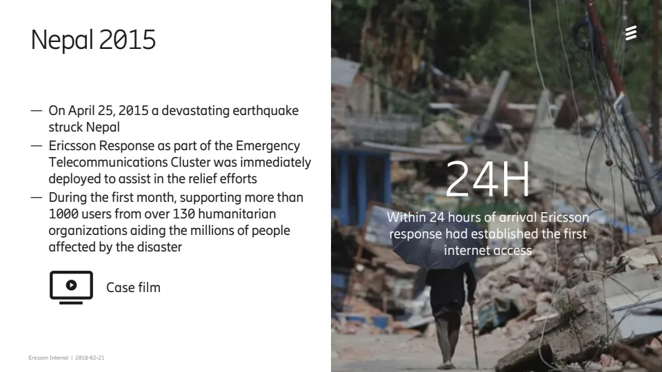

Ericsson Internal | 2018-02-21
— On April 25, 2015 a devastating earthquake 
struck Nepal 
— Ericsson Response as part of the Emergency 
Telecommunications Cluster was immediately 
deployed to assist in the relief efforts
— During the first month, supporting more than 
1000 users from over 130 humanitarian 
organizations aiding the millions of people 
affected by the disaster
Nepal 2015
Case film
24H
Within 24 hours of arrival Ericsson 
response had established the first 
internet access

## Slide 17 - `a0ce9da497f5:17:8cd73d46`

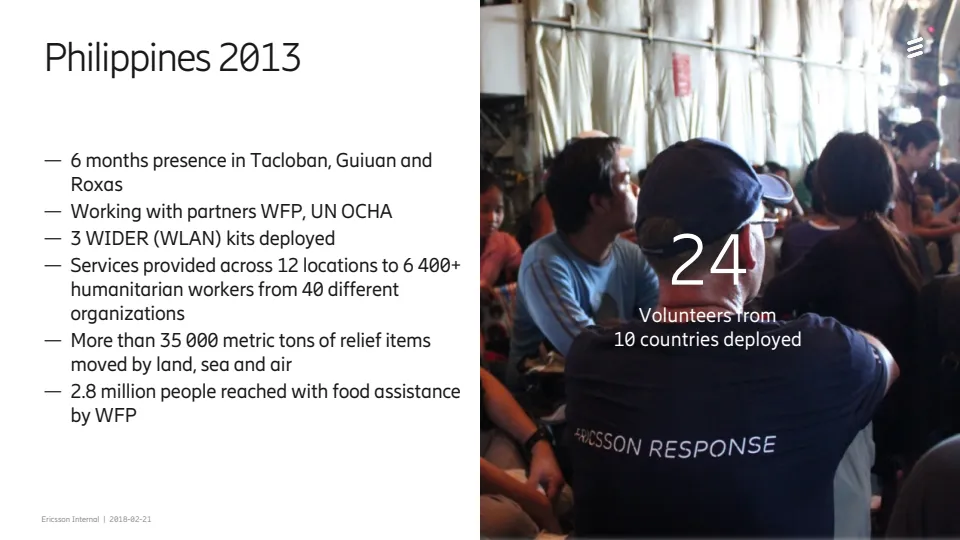

Ericsson Internal | 2018-02-21
— 6 months presence in Tacloban, Guiuan and 
Roxas
— Working with partners WFP, UN OCHA
— 3 WIDER (WLAN) kits deployed
— Services provided across 12 locations to 6 400+ 
humanitarian workers from 40 different 
organizations
— More than 35 000 metric tons of relief items 
moved by land, sea and air
— 2.8 million people reached with food assistance 
by WFP
Philippines 2013
24
Volunteers from
10 countries deployed

## Slide 18 - `a0ce9da497f5:18:de939782`

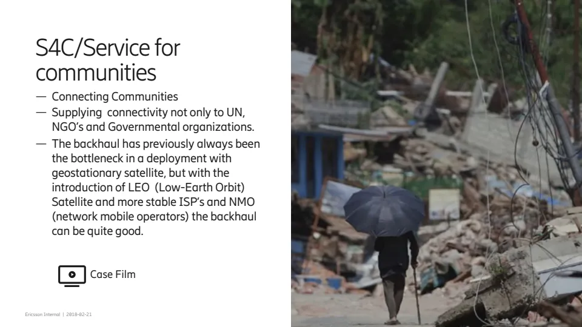

Ericsson Internal | 2018-02-21
— Connecting Communities
— Supplying connectivity not only to UN, 
NGO’s and Governmental organizations.
— The backhaul has previously always been 
the bottleneck in a deployment with 
geostationary satellite, but with the 
introduction of LEO (Low-Earth Orbit) 
Satellite and more stable ISP’s and NMO 
(network mobile operators) the backhaul 
can be quite good. 
S4C/Service for 
communities
Case Film

## Slide 19 - `a0ce9da497f5:19:2f10973c`

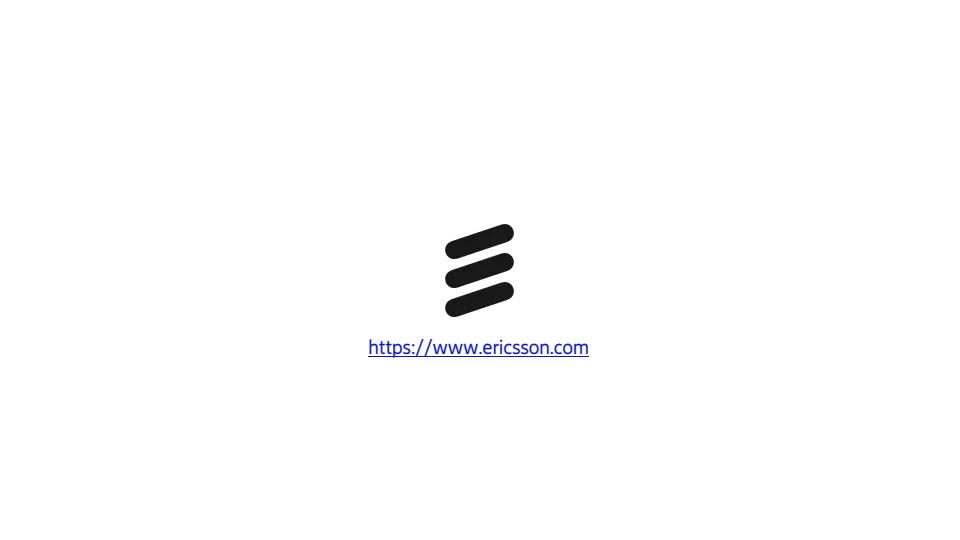

Characters for Embedded characters:
!"#$%&'()*+,./0123456789:;<=>?@ABCDEFGHIJKLMNOPQRSTUVWXYZ[\]^_`abcdefghijklmnopqrstuvwxyz{|}~¡¢£¤¥¦§¨©ª«¬®¯°±²³´¶·¸¹º»¼½À
ÁÂÃÄÅÆÇÈËÌÍÎÏÐÑÒÓÔÕÖ×ØÙÚÛÜÝÞßàáâãäåæçèéêëìíîïðñòóôõö÷øùúûüýþÿĀāĂăąĆćĊċČčĎďĐđĒĖėĘęĚěĞğĠġĢģĪīĮįİıĶķĹĺĻļĽľŁłŃńŅņŇňŌŐő
ŒœŔŕŖŗŘřŚśŞşŠšŢţŤťŪūŮůŰűŲųŴŵŶŷŸŹźŻżŽžƒȘșˆˇ˘˙˚˛˜˝ẀẁẃẄẅỲỳ‘’‚“”„†‡•…‰‹›⁄€™ĀĀĂĂĄĄĆĆĊĊČČĎĎĐĐĒĒĖĖĘĘĚĚĞĞĠĠĢĢĪĪĮĮİĶĶĹĹĻ
ĻĽĽŃŃŅŅŇŇŌŌŐŐŔŔŖŖŘŘŚŚŞŞŢŢŤŤŪŪŮŮŰŰŲŲŴŴŶŶŹŹŻŻȘș−≤≥fiflΆΈΉΊΌΎΏΐΑΒΓΕΖΗΘΙΚΛΜΝΞΟΠΡΣΤΥΦΧΨΪΫΆΈΉΊΰαβγδεζηθικλνξορς
ΣΤΥΦΧΨΩΪΫΌΎΏЁЂЃЄЅІЇЈЉЊЋЌЎЏАБВГДЕЖЗИЙКЛМНОПРСТУФХЦЧШЩЪЫЬЭЮЯАБВГДЕЖЗИЙКЛМНОПРСТУФХЦЧШЩЪЫЬЭЮЯЁЂЃ
ЄЅІЇЈЉЊЋЌЎЏѢѢѲѲѴѴҐҐәǽẀẁẂẃẄẅỲỳ№—–-
!"#$%&'()*+,./0123456789:;<=>?@ABCDEFGHIJKLMNOPQRSTUVWXYZ[\]^_`abcdefghijklmnopqrstuvwxyz{|}~¡¢£¤¥¦§¨©ª«¬®¯°±²³´¶·¸¹º»¼
½ÀÁÂÃÄÅÆÇÈËÌÍÎÏÐÑÒÓÔÕÖ×ØÙÚÛÜÝÞßàáâãäåæçèéêëìíîïðñòóôõö÷øùúûüýþÿĀāĂăąĆćĊċČčĎďĐđĒĖėĘęĚěĞğĠġĢģĪīĮįİıĶķĹĺĻļĽľŁłŃńŅņ
ŇňŌŐőŒœŔŕŖŗŘřŚśŞşŠšŢţŤťŪūŮůŰűŲųŴŵŶŷŸŹźŻżŽžƒȘșˆˇ˘˙˚˛˜˝ẀẁẃẄẅỲỳ‘’‚“”„†‡•…‰‹›⁄€™ĀĀĂĂĄĄĆĆĊĊČČĎĎĐĐĒĒĖĖĘĘĚĚĞĞĠĠĢĢ
ĪĪĮĮİĶĶĹĹĻĻĽĽŃŃŅŅŇŇŌŌŐŐŔŔŖŖŘŘŚŚŞŞŢŢŤŤŪŪŮŮŰŰŲŲŴŴŶŶŹŹŻŻȘș−≤≥fiflΆΈΉΊΌΎΏΐΑΒΓΕΖΗΘΙΚΛΜΝΞΟΠΡΣΤΥΦΧΨΪΫΆΈΉΊΰαβ
γδεζηθικλνξορςΣΤΥΦΧΨΩΪΫΌΎΏЁЂЃЄЅІЇЈЉЊЋЌЎЏАБВГДЕЖЗИЙКЛМНОПРСТУФХЦЧШЩЪЫЬЭЮЯАБВГДЕЖЗИЙКЛМНОПРСТУФХЦ
ЧШЩЪЫЬЭЮЯЁЂЃЄЅІЇЈЉЊЋЌЎЏѢѢѲѲѴѴҐҐәǽẀẁẂẃẄẅỲỳ№—–-
!"#$%&'()*+,./0123456789:;<=>?@ABCDEFGHIJKLMNOPQRSTUVWXYZ[\]^_`abcdefghijklmnopqrstuvwxyz{|}~¡¢£¤¥¦§¨©ª«¬®¯°±²³´¶·¸¹º»¼½ÀÁ
ÂÃÄÅÆÇÈËÌÍÎÏÐÑÒÓÔÕÖ×ØÙÚÛÜÝÞßàáâãäåæçèéêëìíîïðñòóôõö÷øùúûüýþÿĀāĂăąĆćĊċČčĎďĐđĒĖėĘęĚěĞğĠġĢģĪīĮįİıĶķĹĺĻļĽľŁłŃńŅņŇňŌŐőŒœ
ŔŕŖŗŘřŚśŞşŠšŢţŤťŪūŮůŰűŲųŴŵŶŷŸŹźŻżŽžƒȘșˆˇ˘˙˚˛˜˝ẀẁẃẄẅỲỳ‘’‚“”„†‡•…‰‹›⁄€™ĀĀĂĂĄĄĆĆĊĊČČĎĎĐĐĒĒĖĖĘĘĚĚĞĞĠĠĢĢĪĪĮĮİĶĶĹĹĻĻĽĽŃŃ
ŅŅŇŇŌŌŐŐŔŔŖŖŘŘŚŚŞŞŢŢŤŤŪŪŮŮŰŰŲŲŴŴŶŶŹŹŻŻȘș−≤≥fiflΆΈΉΊΌΎΏΐΑΒΓΕΖΗΘΙΚΛΜΝΞΟΠΡΣΤΥΦΧΨΪΫΆΈΉΊΰαβγδεζηθικλνξορςΣΤΥΦΧΨ
ΩΪΫΌΎΏЁЂЃЄЅІЇЈЉЊЋЌЎЏАБВГДЕЖЗИЙКЛМНОПРСТУФХЦЧШЩЪЫЬЭЮЯАБВГДЕЖЗИЙКЛМНОПРСТУФХЦЧШЩЪЫЬЭЮЯЁЂЃЄЅІЇЈЉЊЋ
ЌЎЏѢѢѲѲѴѴҐҐәǽẀẁẂẃẄẅỲỳ№—–-
!"#$%&'()*+,./0123456789:;<=>?@ABCDEFGHIJKLMNOPQRSTUVWXYZ[\]^_`abcdefghijklmnopqrstuvwxyz{|}~¡¢£¤¥¦§¨©ª«¬®¯°±²³´¶·¸¹º»¼
½ÀÁÂÃÄÅÆÇÈËÌÍÎÏÐÑÒÓÔÕÖ×ØÙÚÛÜÝÞßàáâãäåæçèéêëìíîïðñòóôõö÷øùúûüýþÿĀāĂăąĆćĊċČčĎďĐđĒĖėĘęĚěĞğĠġĢģĪīĮįİıĶķĹĺĻļĽľŁłŃńŅņŇ
ňŌŐőŒœŔŕŖŗŘřŚśŞşŠšŢţŤťŪūŮůŰűŲųŴŵŶŷŸŹźŻżŽžƒȘșˆˇ˘˙˚˛˜˝ẀẁẃẄẅỲỳ‘’‚“”„†‡•…‰‹›⁄€™ĀĀĂĂĄĄĆĆĊĊČČĎĎĐĐĒĒĖĖĘĘĚĚĞĞĠĠĢĢĪĪĮĮ
İĶĶĹĹĻĻĽĽŃŃŅŅŇŇŌŌŐŐŔŔŖŖŘŘŚŚŞŞŢŢŤŤŪŪŮŮŰŰŲŲŴŴŶŶŹŹŻŻȘș−≤≥fiflΆΈΉΊΌΎΏΐΑΒΓΕΖΗΘΙΚΛΜΝΞΟΠΡΣΤΥΦΧΨΪΫΆΈΉΊΰαβγδεζ
ηθικλνξορςΣΤΥΦΧΨΩΪΫΌΎΏЁЂЃЄЅІЇЈЉЊЋЌЎЏАБВГДЕЖЗИЙКЛМНОПРСТУФХЦЧШЩЪЫЬЭЮЯАБВГДЕЖЗИЙКЛМНОПРСТУФХЦЧШЩ
ЪЫЬЭЮЯЁЂЃЄЅІЇЈЉЊЋЌЎЏѢѢѲѲѴѴҐҐәǽẀẁẂẃẄẅỲỳ№—–-
https://www.ericsson.com
